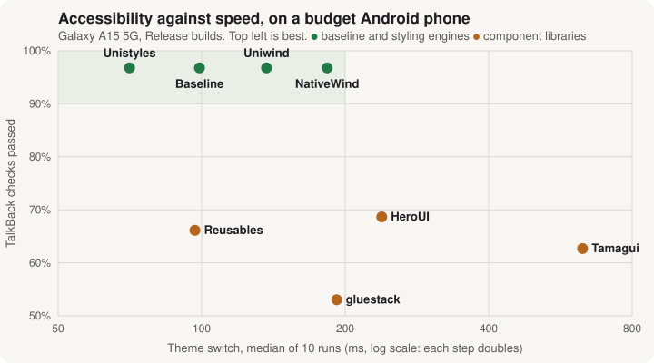

# am-ui-lab

> **🌐 [See the results as an interactive site](https://asmalik107.github.io/am-ui-lab/)**: a sortable scorecard, every check with filters, and the charts.

<!-- begin:nav -->
**The docs:**

- **README** (this page): the answer, the scorecard and each library
- [Site](https://asmalik107.github.io/am-ui-lab/): the scorecard, every check and the charts, sortable and filterable
- [Results](docs/results.md): every check, with the iOS and Android numbers
- [Method](docs/method.md): how each check was measured, its limits, and how to reproduce it
- [iOS accessibility](docs/ios-accessibility.md): every iOS accessibility failure, with the line of code that causes it
- [Android accessibility](docs/android-accessibility.md): every Android accessibility failure, from the audit’s output
- [All checks](docs/checks.md): every accessibility check for every app, one table per component, plus the charts
<!-- end:nav -->

A side-by-side comparison of React Native UI libraries on iOS and Android.

- **Built on**
  <!-- begin:stack -->
  - [Expo SDK 57 (expo 57.0.31)](https://docs.expo.dev/versions/v57.0.0/)
  - [React Native 0.86.3](https://github.com/react/react-native/releases/tag/v0.86.3)
  - [New Architecture](https://reactnative.dev/architecture/landing-page)
  - [React 19.2.3](https://github.com/react/react/releases/tag/v19.2.3)
  - [Reanimated 4.5.1](https://github.com/software-mansion/react-native-reanimated/releases/tag/4.5.1)
  - [expo-router 57.0.29](https://docs.expo.dev/versions/v57.0.0/sdk/router/)
  <!-- end:stack -->
- **Same screen:** every library builds the same test screen, from the same tokens and copy.
- **Compared against:** a plain React Native app with no library, the baseline.
- **Same checks:** every app goes through the same scripted checks, on both platforms.
- **Measured only:** every number was measured. Where something couldn't be, the docs say so.

## What is being compared

<!-- begin:kinds -->
**Baseline**

This project’s own reference app, not a library.

- Plain React Native, with every component written by hand
- Accessibility written by hand too
- Every library is measured against it

**Styling engines**

They style components you write yourself. Here they restyle the baseline’s components, so they keep its accessibility.

- [Unistyles](https://www.unistyl.es) 3.6.0
- [Uniwind](https://uniwind.dev) 1.13.0
  - Tailwind 4.3.3
- [NativeWind](https://www.nativewind.dev) 5.0.0-rc.0
  - react-native-css 3.1.0-rc.0
  - Tailwind 4.1.12

**Component libraries**

Ready-made buttons, dialogs, sheets and more, each with its own accessibility.

- [Tamagui](https://tamagui.dev) 3.1.2
- [gluestack](https://gluestack.io) 5.0.15
  - The version of @gluestack-ui/core
  - On Uniwind 1.13.0
- [HeroUI Native](https://heroui.com/docs/native) 1.0.11
  - On Uniwind 1.13.0
- [React Native Reusables](https://reactnativereusables.com) CLI 0.7.1
  - @rn-primitives 1.5.2
  - On Uniwind 1.13.0
<!-- end:kinds -->

## The answer

<!-- begin:verdict -->
> [!NOTE]
> **On the iPhone simulator:** the libraries are almost equally fast.
>
> **On a budget Android phone:** some are much slower.

- **Accessibility depends on who writes the components**
  - **Baseline and styling engines**
    - TalkBack: 60 of 62 checks
    - VoiceOver: 58 of 62 checks
  - **Component libraries:** 55–70% of checks
- **Speed differences only show on the real phone**
  - **Galaxy A15:** a theme switch takes
    - Unistyles: 71 ms, the fastest
    - Tamagui: 630 ms, the slowest
  - **iPhone simulator:** every app but Tamagui finishes within a frame or two
- **Unistyles is the best all-rounder**
  - Fastest theme switch on the phone
  - Fewest re-renders
  - The baseline’s accessibility
- **Each component library costs you something**
  - **HeroUI:** memory grows by 216 MiB
  - **Their code copied into your app**
    - gluestack: 7,488 lines
    - Reusables: 1,519 lines
  - **Reusables:** button labels cut off at large text sizes
  - **Tamagui:** the slowest app, 630 ms per theme switch on the phone

### Pick by what you need

- **Accessibility and speed first: Unistyles**
  - Fastest theme switch on the phone
  - The baseline’s accessibility
- **Tailwind classes: Uniwind**
  - Faster than NativeWind on the phone
    - Uniwind: 137 ms
    - NativeWind: 183 ms
- **Ready-made components: HeroUI**
  - The most accessible component library
    - TalkBack: 47 of 67
    - VoiceOver: 44 of 67
  - Its memory grows the most on the phone: +216 MiB after use
  - Accessibility gaps you’d fix yourself
    - Labelled switch and checkbox rows hide the control’s name, role and state
    - The field error isn’t linked to the field
- **Theme switching on a budget Android phone**
  - **Slowest:** Tamagui, 630 ms, about 6 times the baseline
  - **Fastest:** Unistyles, 71 ms
  - **Level with the baseline (99 ms):** Reusables, 97 ms
  - **The rest:** 137–239 ms
    - Uniwind: 137 ms
    - NativeWind: 183 ms
    - gluestack: 192 ms
    - HeroUI: 239 ms
<!-- end:verdict -->

## Scorecard

One row per app.

- 🟢 **Bold** is the best in each column, 🔴 the worst.
- **Accessibility:** every check, in the light theme.
- **Theme switch and memory:** on the Galaxy A15.
- **Bundle size and re-renders:** on iOS. The JS is the same on both platforms.
- **Each column** links to its section in [Results](docs/results.md), listed under the table.

<!-- begin:scorecard -->
| App | [Accessibility, iOS](docs/results.md#accessibility) | [Accessibility, Android](docs/results.md#accessibility) | [Theme switch, Android](docs/results.md#timings) | [Memory growth, Android](docs/results.md#startup-memory-and-scrolling) | [JS bundle](docs/results.md#bundle-size-and-re-renders-ios) | [Re-renders per theme switch](docs/results.md#bundle-size-and-re-renders-ios) | [Library code copied in](docs/results.md#developer-cost) |
| --- | --- | --- | --- | --- | --- | --- | --- |
| [Baseline](#baseline-plain-react-native-the-reference-point) | 🟢 **58 / 62** | 🟢 **60 / 62** | 99 ms | +50 MiB | 🟢 **3.95 MB** | 298 | 0 |
| [Unistyles](#unistyles-360-best-all-rounder) | 🟢 **58 / 62** | 🟢 **60 / 62** | 🟢 **71 ms** | +54 MiB | 4.15 MB | 🟢 **128** | 0 |
| [Uniwind](#uniwind-1130-best-if-you-want-tailwind-classes) | 🟢 **58 / 62** | 🟢 **60 / 62** | 137 ms | +51 MiB | 4.24 MB | 507 | 0 |
| [NativeWind](#nativewind-500-rc0-tailwind-still-a-release-candidate) | 🟢 **58 / 62** | 🟢 **60 / 62** | 183 ms | 🟢 **+32 MiB** | 4.47 MB | 460 | 0 |
| [Tamagui](#tamagui-312-slowest-on-both-platforms) | 36 / 57 | 42 / 67 | 🔴 630 ms | +46 MiB | 5.44 MB | not measured | 0 |
| [gluestack](#gluestack-5015-most-code-to-own) | 🔴 35 / 66 | 🔴 36 / 66 | 192 ms | +103 MiB | 5.66 MB | 815 | 🔴 7,488 |
| [HeroUI](#heroui-1011-the-most-accessible-component-library) | 44 / 67 | 47 / 67 | 239 ms | 🔴 +216 MiB | 5.24 MB | 🔴 1,137 | 0 |
| [Reusables](#reusables-cli-071-fast-with-rough-edges) | 37 / 62 | 37 / 62 | 97 ms | +48 MiB | 🔴 6.83 MB | 603 | 1,519 |
<!-- end:scorecard -->

<!-- begin:scorecardlinks -->
**Where each column comes from,** in [Results](docs/results.md):

- **Accessibility, iOS:** [Accessibility](docs/results.md#accessibility)
- **Accessibility, Android:** [Accessibility](docs/results.md#accessibility)
- **Theme switch, Android:** [Timings](docs/results.md#timings)
- **Memory growth, Android:** [Startup, memory and scrolling](docs/results.md#startup-memory-and-scrolling)
- **JS bundle:** [Bundle size and re-renders](docs/results.md#bundle-size-and-re-renders-ios)
- **Re-renders per theme switch:** [Bundle size and re-renders](docs/results.md#bundle-size-and-re-renders-ios)
- **Library code copied in:** [Developer cost](docs/results.md#developer-cost)
<!-- end:scorecardlinks -->

## Library by library

Best first.

- ✅ what it is good at
- ⚠️ its problems
- The full numbers for every check are in [Results](docs/results.md).

<!-- begin:libraries -->

### Unistyles 3.6.0: Best all-rounder

*Styling engine*

- ✅ Fastest theme switch on the phone
  - Unistyles: 71 ms
  - Baseline: 99 ms
- ✅ Fewest re-renders per theme switch
  - Unistyles: 128
  - Baseline: 298
- ✅ The baseline’s accessibility, as the components are hand-built
  - TalkBack: 60 of 62
  - VoiceOver: 58 of 62
- ⚠️ You build every component yourself, as with the baseline

[Setup notes](apps/unistyles/NOTES.md) · [Raw results](results/unistyles/)

### Uniwind 1.13.0: Best if you want Tailwind classes

*Styling engine*

- ✅ The baseline’s accessibility
  - TalkBack: 60 of 62
  - VoiceOver: 58 of 62
- ✅ No setup problems hit
- ⚠️ You build every component yourself, as with the baseline
- ⚠️ Slower theme switch on the phone
  - Uniwind: 137 ms
  - Baseline: 99 ms
- ⚠️ More re-renders per theme switch
  - Uniwind: 507
  - Unistyles: 128

[Setup notes](apps/uniwind/NOTES.md) · [Raw results](results/uniwind/)

### NativeWind 5.0.0-rc.0: Tailwind, still a release candidate

*Styling engine*

- ✅ The baseline’s accessibility
  - TalkBack: 60 of 62
  - VoiceOver: 58 of 62
- ✅ Least memory growth on the phone: +32 MiB
- ⚠️ You build every component yourself, as with the baseline
- ⚠️ Still a release candidate (5.0.0-rc.0)
  - Needed a line-height workaround
  - Without it, the page was 18 screens tall
- ⚠️ Theme switch on the phone: 183 ms

[Setup notes](apps/nativewind/NOTES.md) · [Raw results](results/nativewind/)

### Baseline: Plain React Native, the reference point

*Baseline*

- ✅ Top accessibility score
  - TalkBack: 60 of 62
  - VoiceOver: 58 of 62
- ✅ Smallest bundle: 3.95 MB
- ⚠️ Everything written by hand
  - Every component
  - All 75 accessibility props

[Raw results](results/baseline/)

### HeroUI 1.0.11: The most accessible component library

*Component library*

- ✅ Best accessibility of the component libraries
  - TalkBack: 47 of 67
  - VoiceOver: 44 of 67
- ⚠️ Memory grows the most on the phone: +216 MiB after use
- ⚠️ Most re-renders per theme switch: 1,137
- ⚠️ Theme switch on the phone: 239 ms
- ⚠️ Labelled switch and checkbox rows hide the control’s name, role and state

[Setup notes](apps/heroui/NOTES.md) · [Raw results](results/heroui/)

### Reusables CLI 0.7.1: Fast, with rough edges

*Component library*

- ✅ Theme switch on the phone level with the baseline
  - Reusables: 97 ms
  - Baseline: 99 ms
- ⚠️ Largest bundle
  - 6.83 MB
  - Bundles all 1,917 lucide icons and uses 4
- ⚠️ Button labels are cut off at the largest text size, on both platforms
- ⚠️ Low accessibility
  - TalkBack: 37 of 62
  - VoiceOver: 37 of 62
- ⚠️ The checkbox is 16 dp tall on the phone, under the 48 dp minimum
- ⚠️ Progress always reads 0%
- ⚠️ Copies 1,519 lines of its code into your app

[Setup notes](apps/reusables/NOTES.md) · [Raw results](results/reusables/)

### gluestack 5.0.15: Most code to own

*Component library*

- ✅ Fewest setup steps: 5
- ⚠️ Copies its code into your app
  - 7,488 lines
  - 17 type errors in them
- ⚠️ Lowest accessibility
  - TalkBack: 36 of 66
  - VoiceOver: 35 of 66
- ⚠️ Controls too small to tap on the phone, under Google’s 48 dp minimum
  - Slider: 6 dp
  - Accordion: 20 dp
  - Checkbox: 22 dp
  - Radio option: 22 dp
  - Switch: 27 dp
  - Tab: 31 dp
  - Button: 36 dp
  - Menu: 38 dp
  - Select trigger: 40 dp
  - Segmented control: 44 dp
- ⚠️ Most setup problems hit: 8, listed in [its notes](apps/gluestack/NOTES.md#errors-hit-and-fixes)
  - The CLI hung while cloning
  - The CLI dropped Metro watchFolders
  - The CLI mangled _layout.tsx
  - The CLI moved native modules off the SDK pins
  - The CLI added a redundant worklets Babel plugin
  - The docs and the code disagree
  - TS6 side-effect import error
  - withUniwind lost gorhom's generic
- ⚠️ Memory grows by 103 MiB on the phone

[Setup notes](apps/gluestack/NOTES.md) · [Raw results](results/gluestack/)

### Tamagui 3.1.2: Slowest on both platforms

*Component library*

- ✅ A full component library with its own compiler
- ✅ Only 12 accessibility props written by hand
- ⚠️ Slowest theme switch
  - Phone: 630 ms, about 6 times the baseline
  - iOS: 99 ms
- ⚠️ Low accessibility
  - TalkBack: 42 of 67
  - VoiceOver: 36 of 57
- ⚠️ The switch and checkbox have no name
- ⚠️ Its Debug build crashes, so re-renders aren’t counted
- ⚠️ Select and Accordion couldn’t be tested on iOS

[Setup notes](apps/tamagui/NOTES.md) · [Raw results](results/tamagui/)
<!-- end:libraries -->

## What was tested

|  | iOS | Android |
| --- | --- | --- |
| Device | iPhone 17 simulator, iOS 27.0 (Xcode 27.1) | Samsung Galaxy A15 5G (SM-A156E), Android 16. A physical budget phone. |
| Screen reader whose tree is checked | VoiceOver | TalkBack |
| Last run | 30 October 2026 | 30–31 October 2026 |

- **Builds:** Release
  - Except the re-render counts: Debug, iOS only

**The test screen** has 19 items. Its full spec is in [Method](docs/method.md#the-test-screen).

- Buttons and form controls
- Overlays: dialog, bottom sheet, select, menu, toast
- A 200-row list and a theme switcher
- A slider, progress bar, accordion and segmented control

**Each app's `NOTES.md`** records:

- Exact versions
- Every setup step and config file touched
- Every error hit, and how it was fixed
- Which items use the library's components and which are hand-built
