

# All checks

<!-- begin:nav -->
**The docs:**

- [README](../README.md): the answer, the scorecard and each library
- [Site](https://asmalik107.github.io/am-ui-lab/): the scorecard, every check and the charts, sortable and filterable
- [Results](results.md): every check, with the iOS and Android numbers
- [Method](method.md): how each check was measured, its limits, and how to reproduce it
- [iOS accessibility](ios-accessibility.md): every iOS accessibility failure, with the line of code that causes it
- [Android accessibility](android-accessibility.md): every Android accessibility failure, with the line of code that causes it
- **All checks** (this page): every accessibility check for every app, one table per component, plus the charts
- [To do](../TODO.md): what is left to measure, and how
<!-- end:nav -->

Every accessibility check, for every app, with iOS and Android side by side. Generated from `results/` by `scripts/checks-md.mjs`.

- **The summary tables** (scores, text size, reduced motion, speed, memory, developer cost) are in [Results](results.md).
- **How each check works** is in [Method](method.md#accessibility-checks).

## Contents

- [How to read the tables](#how-to-read-the-tables)
- [Accessibility checks](#accessibility-checks)
- [Dark and brand themes](#dark-and-brand-themes)
- [Charts](#charts)

## How to read the tables

- **Each cell** is iOS / Android.
- **Measured on** iOS: iPhone 17 simulator (iOS 27.0). Android: Galaxy A15 5G (Android 16).
- ✅ pass, ❌ fail.
- ➖ not applicable: the app has no such element.
- **n/r** not run: the test could not start.
- ⚠️ the two platforms give different results.
- **Under each table**, two fold-outs say what each check means, with a picture of a pass and a fail, and why any check failed.
- **NativeWind** results use a line-height workaround. See `apps/nativewind/NOTES.md`.

## Accessibility checks

**Checks that give a different result on iOS and Android,** per app:

- **Baseline:** 2
- **Unistyles:** 2
- **Uniwind:** 2
- **NativeWind:** 2
- **HeroUI:** 8
- **gluestack:** 5
- **Tamagui:** 5
- **Reusables:** 11

### Button

| Check | Baseline iOS / Android | Unistyles iOS / Android | Uniwind iOS / Android | NativeWind iOS / Android | HeroUI iOS / Android | gluestack iOS / Android | Tamagui iOS / Android | Reusables iOS / Android |
| --- | --- | --- | --- | --- | --- | --- | --- | --- |
| name, role, state | ✅ / ✅ | ✅ / ✅ | ✅ / ✅ | ✅ / ✅ | ✅ / ✅ | ✅ / ✅ | ✅ / ✅ | ✅ / ✅ |
| touch target | ✅ / ✅ | ✅ / ✅ | ✅ / ✅ | ✅ / ✅ | ✅ / ✅ | ❌ / ❌ | ✅ / ✅ | ❌ / ❌ |

What each check means

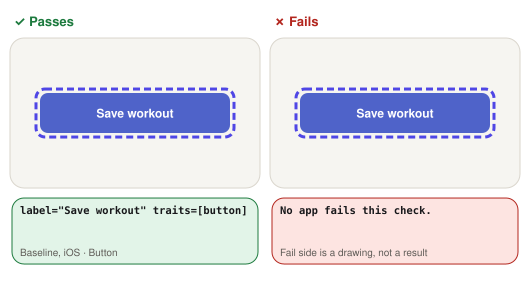

- **name, role, state:** Reads the control from the accessibility tree.
  - **Passes:** It has a label, the right role (button, switch, checkbox…) and its current state: disabled, busy, on/off, checked or selected.
  - **Fails:** Any of the three is missing or wrong, e.g. a switch read as just “Workout reminders”.

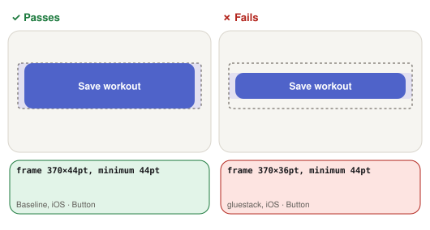

- **touch target:** Measures the control’s frame in the accessibility tree.
  - **Passes:** At least 44 × 44 pt on iOS (Apple’s default control size) and 48 × 48 dp on Android (Google’s minimum).
  - **Fails:** Either side is smaller, so it is easy to miss with a finger.

All checks, with their pictures: [Method](method.md#checks-in-pictures).

Why checks failed

- **gluestack**
  - iOS, touch target: 370×36pt
  - Android, touch target: 352×36dp
- **Reusables**
  - iOS, touch target: 370×40pt
  - Android, touch target: 352×40dp

### Button (disabled)

| Check | Baseline iOS / Android | Unistyles iOS / Android | Uniwind iOS / Android | NativeWind iOS / Android | HeroUI iOS / Android | gluestack iOS / Android | Tamagui iOS / Android | Reusables iOS / Android |
| --- | --- | --- | --- | --- | --- | --- | --- | --- |
| name, role, state | ✅ / ✅ | ✅ / ✅ | ✅ / ✅ | ✅ / ✅ | ✅ / ✅ | ✅ / ✅ | ❌ / ✅ ⚠️ | ✅ / ✅ |
| touch target | ✅ / ✅ | ✅ / ✅ | ✅ / ✅ | ✅ / ✅ | ✅ / ✅ | ❌ / ❌ | ➖ / ✅ | ❌ / ❌ |

What each check means

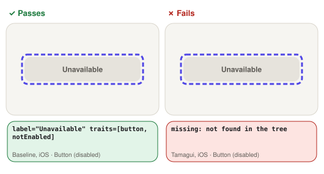

- **name, role, state:** Reads the control from the accessibility tree.
  - **Passes:** It has a label, the right role (button, switch, checkbox…) and its current state: disabled, busy, on/off, checked or selected.
  - **Fails:** Any of the three is missing or wrong, e.g. a switch read as just “Workout reminders”.

- **touch target:** Measures the control’s frame in the accessibility tree.
  - **Passes:** At least 44 × 44 pt on iOS (Apple’s default control size) and 48 × 48 dp on Android (Google’s minimum).
  - **Fails:** Either side is smaller, so it is easy to miss with a finger.

All checks, with their pictures: [Method](method.md#checks-in-pictures).

Why checks failed

- **gluestack**
  - iOS, touch target: 370×36pt
  - Android, touch target: 352×36dp
- **Tamagui**
  - iOS, name, role, state: missing
- **Reusables**
  - iOS, touch target: 370×40pt
  - Android, touch target: 352×40dp

### Button (loading)

| Check | Baseline iOS / Android | Unistyles iOS / Android | Uniwind iOS / Android | NativeWind iOS / Android | HeroUI iOS / Android | gluestack iOS / Android | Tamagui iOS / Android | Reusables iOS / Android |
| --- | --- | --- | --- | --- | --- | --- | --- | --- |
| name, role, state | ✅ / ✅ | ✅ / ✅ | ✅ / ✅ | ✅ / ✅ | ❌ / ❌ | ✅ / ❌ ⚠️ | ❌ / ❌ | ❌ / ❌ |
| touch target | ✅ / ✅ | ✅ / ✅ | ✅ / ✅ | ✅ / ✅ | ✅ / ✅ | ❌ / ❌ | ➖ / ✅ | ❌ / ❌ |

What each check means

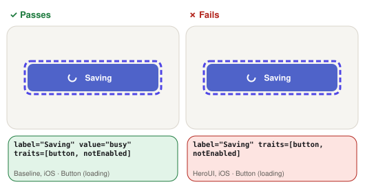

- **name, role, state:** Reads the control from the accessibility tree.
  - **Passes:** It has a label, the right role (button, switch, checkbox…) and its current state: disabled, busy, on/off, checked or selected.
  - **Fails:** Any of the three is missing or wrong, e.g. a switch read as just “Workout reminders”.

- **touch target:** Measures the control’s frame in the accessibility tree.
  - **Passes:** At least 44 × 44 pt on iOS (Apple’s default control size) and 48 × 48 dp on Android (Google’s minimum).
  - **Fails:** Either side is smaller, so it is easy to miss with a finger.

All checks, with their pictures: [Method](method.md#checks-in-pictures).

Why checks failed

- **HeroUI**
  - iOS, name, role, state: label="Saving" value="" traits=[button, notEnabled] 370×48pt
  - Android, name, role, state: label="Saving" value="" traits=[button, notEnabled] 352×48dp
- **gluestack**
  - Android, name, role, state: label="Saving" value="" traits=[button, notEnabled] 352×36dp
  - iOS, touch target: 370×36pt
  - Android, touch target: 352×36dp
- **Tamagui**
  - iOS, name, role, state: missing
  - Android, name, role, state: label="Saving" value="" traits=[button, notEnabled] 352×48dp
- **Reusables**
  - iOS, name, role, state: label="Saving" value="" traits=[button, notEnabled] 370×40pt
  - Android, name, role, state: label="Saving" value="" traits=[button, notEnabled] 352×40dp
  - iOS, touch target: 370×40pt
  - Android, touch target: 352×40dp

### Text field

| Check | Baseline iOS / Android | Unistyles iOS / Android | Uniwind iOS / Android | NativeWind iOS / Android | HeroUI iOS / Android | gluestack iOS / Android | Tamagui iOS / Android | Reusables iOS / Android |
| --- | --- | --- | --- | --- | --- | --- | --- | --- |
| name, role, state | ✅ / ✅ | ✅ / ✅ | ✅ / ✅ | ✅ / ✅ | ❌ / ✅ ⚠️ | ✅ / ✅ | ✅ / ✅ | ❌ / ✅ ⚠️ |
| error shown | ✅ / ✅ | ✅ / ✅ | ✅ / ✅ | ✅ / ✅ | ✅ / ✅ | ✅ / ✅ | ✅ / ✅ | ✅ / ✅ |
| error reachable from field | ✅ / ✅ | ✅ / ✅ | ✅ / ✅ | ✅ / ✅ | ❌ / ❌ | ❌ / ❌ | ✅ / ✅ | ❌ / ❌ |

What each check means

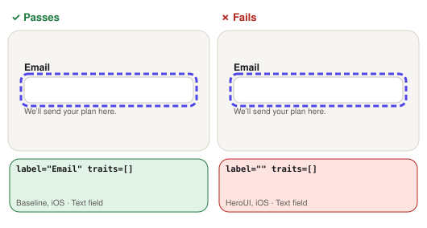

- **name, role, state:** Reads the control from the accessibility tree.
  - **Passes:** It has a label, the right role (button, switch, checkbox…) and its current state: disabled, busy, on/off, checked or selected.
  - **Fails:** Any of the three is missing or wrong, e.g. a switch read as just “Workout reminders”.

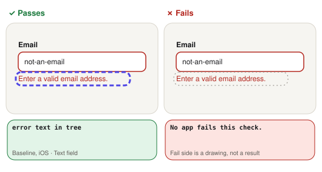

- **error shown:** Types “not-an-email” into the email field, moves focus away, then looks for the error.
  - **Passes:** The message “Enter a valid email” appears in the tree.
  - **Fails:** The error never appears in the tree.

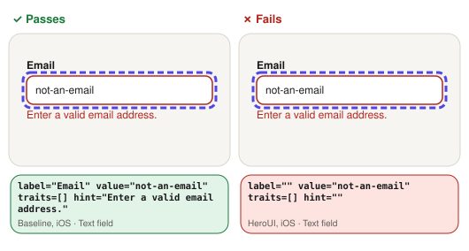

- **error reachable from field:** Reads the email field after the error appears.
  - **Passes:** The error is part of the field’s label, value or hint, so it is read with the field.
  - **Fails:** The field is read without the error, so a screen reader user has to go looking for it.

All checks, with their pictures: [Method](method.md#checks-in-pictures).

Why checks failed

- **HeroUI**
  - iOS, name, role, state: label="" value="" traits=[] 368×46pt
  - iOS, error reachable from field: label="" value="not-an-email" traits=[] 368×46pt hint=""
  - Android, error reachable from field: label="Email" value="not-an-email" traits=[] 352×48dp hint=""
- **gluestack**
  - iOS, error reachable from field: label="Email" value="not-an-email" traits=[] 344×34pt hint=""
  - Android, error reachable from field: label="Email" value="not-an-email" traits=[] 326×34dp hint=""
- **Reusables**
  - iOS, name, role, state: label="" value="" traits=[] 368×38pt
  - iOS, error reachable from field: label="" value="not-an-email" traits=[] 366×36pt hint=""
  - Android, error reachable from field: label="Email" value="not-an-email" traits=[] 352×40dp hint=""

### Switch

| Check | Baseline iOS / Android | Unistyles iOS / Android | Uniwind iOS / Android | NativeWind iOS / Android | HeroUI iOS / Android | gluestack iOS / Android | Tamagui iOS / Android | Reusables iOS / Android |
| --- | --- | --- | --- | --- | --- | --- | --- | --- |
| name, role, state | ✅ / ✅ | ✅ / ✅ | ✅ / ✅ | ✅ / ✅ | ❌ / ❌ | ❌ / ❌ | ❌ / ❌ | ❌ / ✅ ⚠️ |
| touch target | ✅ / ✅ | ✅ / ✅ | ✅ / ✅ | ✅ / ✅ | ❌ / ❌ | ❌ / ❌ | ❌ / ❌ | ❌ / ❌ |

What each check means

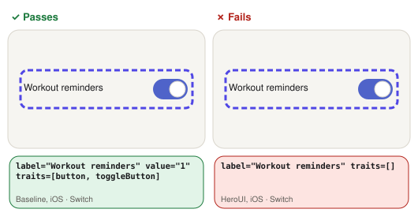

- **name, role, state:** Reads the control from the accessibility tree.
  - **Passes:** It has a label, the right role (button, switch, checkbox…) and its current state: disabled, busy, on/off, checked or selected.
  - **Fails:** Any of the three is missing or wrong, e.g. a switch read as just “Workout reminders”.

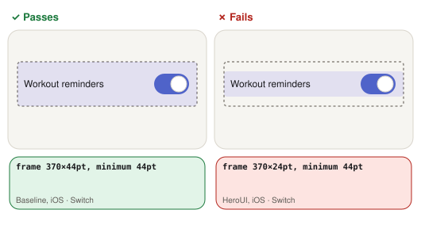

- **touch target:** Measures the control’s frame in the accessibility tree.
  - **Passes:** At least 44 × 44 pt on iOS (Apple’s default control size) and 48 × 48 dp on Android (Google’s minimum).
  - **Fails:** Either side is smaller, so it is easy to miss with a finger.

All checks, with their pictures: [Method](method.md#checks-in-pictures).

Why checks failed

- **HeroUI**
  - iOS, name, role, state: label="Workout reminders" value="" traits=[] 370×24pt
  - Android, name, role, state: label="" value="" traits=[] 352×24dp
  - iOS, touch target: 370×24pt
  - Android, touch target: 352×24dp
- **gluestack**
  - iOS, name, role, state: label="" value="1" traits=[button, toggleButton] 63×28pt
  - Android, name, role, state: label="" value="ON, checked" traits=[toggleButton] 47×27dp
  - iOS, touch target: 63×28pt
  - Android, touch target: 47×27dp
- **Tamagui**
  - iOS, name, role, state: label="" value="" traits=[] 42×22pt
  - Android, name, role, state: label="" value="" traits=[] 42×22dp
  - iOS, touch target: 42×22pt
  - Android, touch target: 42×22dp
- **Reusables**
  - iOS, name, role, state: label="" value="1" traits=[button, toggleButton] 32×19pt
  - iOS, touch target: 32×19pt
  - Android, touch target: 32×18dp

### Checkbox

| Check | Baseline iOS / Android | Unistyles iOS / Android | Uniwind iOS / Android | NativeWind iOS / Android | HeroUI iOS / Android | gluestack iOS / Android | Tamagui iOS / Android | Reusables iOS / Android |
| --- | --- | --- | --- | --- | --- | --- | --- | --- |
| name, role, state | ✅ / ✅ | ✅ / ✅ | ✅ / ✅ | ✅ / ✅ | ❌ / ❌ | ❌ / ❌ | ❌ / ❌ | ❌ / ✅ ⚠️ |
| touch target | ✅ / ✅ | ✅ / ✅ | ✅ / ✅ | ✅ / ✅ | ❌ / ❌ | ❌ / ❌ | ➖ / ❌ | ❌ / ❌ |

What each check means

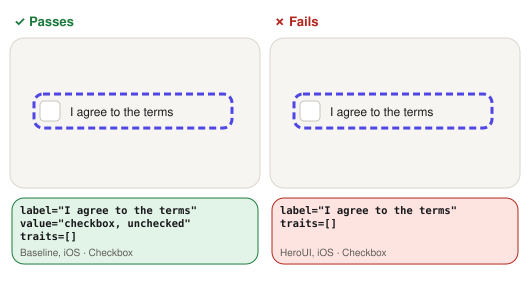

- **name, role, state:** Reads the control from the accessibility tree.
  - **Passes:** It has a label, the right role (button, switch, checkbox…) and its current state: disabled, busy, on/off, checked or selected.
  - **Fails:** Any of the three is missing or wrong, e.g. a switch read as just “Workout reminders”.

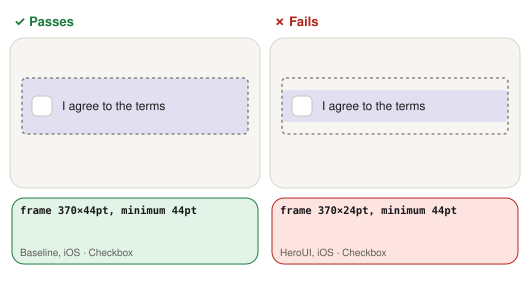

- **touch target:** Measures the control’s frame in the accessibility tree.
  - **Passes:** At least 44 × 44 pt on iOS (Apple’s default control size) and 48 × 48 dp on Android (Google’s minimum).
  - **Fails:** Either side is smaller, so it is easy to miss with a finger.

All checks, with their pictures: [Method](method.md#checks-in-pictures).

Why checks failed

- **HeroUI**
  - iOS, name, role, state: label="I agree to the terms" value="" traits=[] 370×24pt
  - Android, name, role, state: label="" value="" traits=[] 352×24dp
  - iOS, touch target: 370×24pt
  - Android, touch target: 352×24dp
- **gluestack**
  - iOS, name, role, state: label="terms" value="checkbox, unchecked" traits=[] 370×22pt
  - Android, name, role, state: label="terms" value="unchecked" traits=[checkbox] 352×22dp
  - iOS, touch target: 370×22pt
  - Android, touch target: 352×22dp
- **Tamagui**
  - iOS, name, role, state: missing
  - Android, name, role, state: label="" value="unchecked" traits=[checkbox] 22×22dp
  - Android, touch target: 22×22dp
- **Reusables**
  - iOS, name, role, state: label="" value="checkbox, unchecked" traits=[] 16×16pt
  - iOS, touch target: 16×16pt
  - Android, touch target: 16×16dp

### Radio option

| Check | Baseline iOS / Android | Unistyles iOS / Android | Uniwind iOS / Android | NativeWind iOS / Android | HeroUI iOS / Android | gluestack iOS / Android | Tamagui iOS / Android | Reusables iOS / Android |
| --- | --- | --- | --- | --- | --- | --- | --- | --- |
| name, role, state | ✅ / ✅ | ✅ / ✅ | ✅ / ✅ | ✅ / ✅ | ✅ / ✅ | ✅ / ✅ | ✅ / ✅ | ✅ / ✅ |
| touch target | ✅ / ✅ | ✅ / ✅ | ✅ / ✅ | ✅ / ✅ | ❌ / ❌ | ❌ / ❌ | ❌ / ❌ | ❌ / ❌ |

What each check means

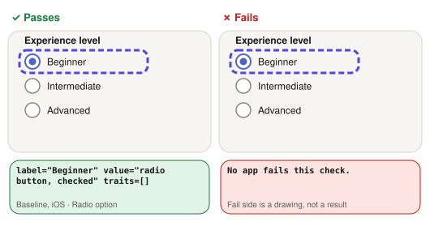

- **name, role, state:** Reads the control from the accessibility tree.
  - **Passes:** It has a label, the right role (button, switch, checkbox…) and its current state: disabled, busy, on/off, checked or selected.
  - **Fails:** Any of the three is missing or wrong, e.g. a switch read as just “Workout reminders”.

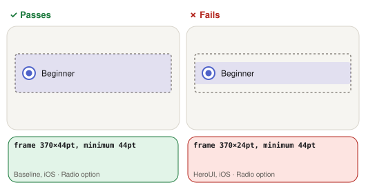

- **touch target:** Measures the control’s frame in the accessibility tree.
  - **Passes:** At least 44 × 44 pt on iOS (Apple’s default control size) and 48 × 48 dp on Android (Google’s minimum).
  - **Fails:** Either side is smaller, so it is easy to miss with a finger.

All checks, with their pictures: [Method](method.md#checks-in-pictures).

Why checks failed

- **HeroUI**
  - iOS, touch target: 370×24pt
  - Android, touch target: 352×24dp
- **gluestack**
  - iOS, touch target: 370×22pt
  - Android, touch target: 352×22dp
- **Tamagui**
  - iOS, touch target: 22×22pt
  - Android, touch target: 22×22dp
- **Reusables**
  - iOS, touch target: 16×16pt
  - Android, touch target: 16×16dp

### Select trigger

| Check | Baseline iOS / Android | Unistyles iOS / Android | Uniwind iOS / Android | NativeWind iOS / Android | HeroUI iOS / Android | gluestack iOS / Android | Tamagui iOS / Android | Reusables iOS / Android |
| --- | --- | --- | --- | --- | --- | --- | --- | --- |
| name, role, state | ❌ / ✅ ⚠️ | ❌ / ✅ ⚠️ | ❌ / ✅ ⚠️ | ❌ / ✅ ⚠️ | ❌ / ❌ | ❌ / ❌ | ❌ / ❌ | ❌ / ✅ ⚠️ |
| touch target | ✅ / ✅ | ✅ / ✅ | ✅ / ✅ | ✅ / ✅ | ✅ / ✅ | ❌ / ❌ | ➖ / ✅ | ❌ / ❌ |

What each check means

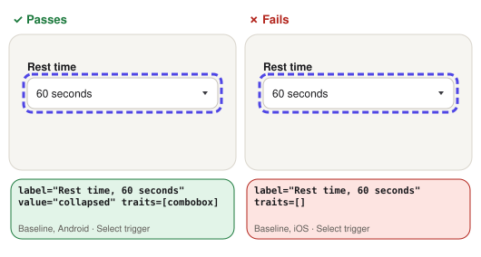

- **name, role, state:** Reads the control from the accessibility tree.
  - **Passes:** It has a label, the right role (button, switch, checkbox…) and its current state: disabled, busy, on/off, checked or selected.
  - **Fails:** Any of the three is missing or wrong, e.g. a switch read as just “Workout reminders”.

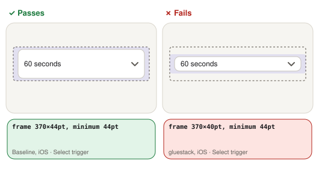

- **touch target:** Measures the control’s frame in the accessibility tree.
  - **Passes:** At least 44 × 44 pt on iOS (Apple’s default control size) and 48 × 48 dp on Android (Google’s minimum).
  - **Fails:** Either side is smaller, so it is easy to miss with a finger.

All checks, with their pictures: [Method](method.md#checks-in-pictures).

Why checks failed

- **Baseline**
  - iOS, name, role, state: label="Rest time, 60 seconds" value="" traits=[] 370×44pt
- **Unistyles**
  - iOS, name, role, state: label="Rest time, 60 seconds" value="" traits=[] 370×44pt
- **Uniwind**
  - iOS, name, role, state: label="Rest time, 60 seconds" value="" traits=[] 370×44pt
- **NativeWind**
  - iOS, name, role, state: label="Rest time, 60 seconds" value="" traits=[] 370×44pt
- **HeroUI**
  - iOS, name, role, state: label="60 seconds" value="" traits=[] 370×50pt
  - Android, name, role, state: label="60 seconds" value="" traits=[combobox] role="Combo box" 352×50dp
- **gluestack**
  - iOS, name, role, state: label="" value="" traits=[button] 370×40pt
  - Android, name, role, state: label="" value="" traits=[button] 352×40dp
  - iOS, touch target: 370×40pt
  - Android, touch target: 352×40dp
- **Tamagui**
  - iOS, name, role, state: missing
  - Android, name, role, state: label="60 seconds" value="collapsed" traits=[combobox] role="Combo box" 352×48dp
- **Reusables**
  - iOS, name, role, state: label="60 seconds" value="" traits=[] 200×40pt
  - iOS, touch target: 200×40pt
  - Android, touch target: 200×40dp

### Tab (selected)

| Check | Baseline iOS / Android | Unistyles iOS / Android | Uniwind iOS / Android | NativeWind iOS / Android | HeroUI iOS / Android | gluestack iOS / Android | Tamagui iOS / Android | Reusables iOS / Android |
| --- | --- | --- | --- | --- | --- | --- | --- | --- |
| name, role, state | ❌ / ✅ ⚠️ | ❌ / ✅ ⚠️ | ❌ / ✅ ⚠️ | ❌ / ✅ ⚠️ | ❌ / ✅ ⚠️ | ❌ / ✅ ⚠️ | ❌ / ✅ ⚠️ | ❌ / ✅ ⚠️ |
| touch target | ✅ / ✅ | ✅ / ✅ | ✅ / ✅ | ✅ / ✅ | ❌ / ❌ | ❌ / ❌ | ✅ / ✅ | ❌ / ❌ |

What each check means

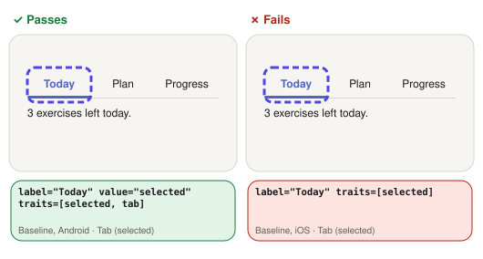

- **name, role, state:** Reads the control from the accessibility tree.
  - **Passes:** It has a label, the right role (button, switch, checkbox…) and its current state: disabled, busy, on/off, checked or selected.
  - **Fails:** Any of the three is missing or wrong, e.g. a switch read as just “Workout reminders”.

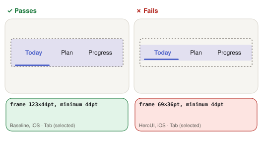

- **touch target:** Measures the control’s frame in the accessibility tree.
  - **Passes:** At least 44 × 44 pt on iOS (Apple’s default control size) and 48 × 48 dp on Android (Google’s minimum).
  - **Fails:** Either side is smaller, so it is easy to miss with a finger.

All checks, with their pictures: [Method](method.md#checks-in-pictures).

Why checks failed

- **Baseline**
  - iOS, name, role, state: label="Today" value="" traits=[selected] 123×44pt
- **Unistyles**
  - iOS, name, role, state: label="Today" value="" traits=[selected] 123×44pt
- **Uniwind**
  - iOS, name, role, state: label="Today" value="" traits=[selected] 123×44pt
- **NativeWind**
  - iOS, name, role, state: label="Today" value="" traits=[selected] 123×44pt
- **HeroUI**
  - iOS, name, role, state: label="Today" value="" traits=[selected] 69×36pt
  - iOS, touch target: 69×36pt
  - Android, touch target: 68×36dp
- **gluestack**
  - iOS, name, role, state: label="Today" value="" traits=[selected] 64×29pt
  - iOS, touch target: 64×29pt
  - Android, touch target: 63×31dp
- **Tamagui**
  - iOS, name, role, state: label="Today" value="" traits=[selected] 123×44pt
- **Reusables**
  - iOS, name, role, state: label="Today" value="" traits=[selected] 58×30pt
  - iOS, touch target: 58×30pt
  - Android, touch target: 57×30dp

### Native switch (@expo/ui)

| Check | Baseline iOS / Android | Unistyles iOS / Android | Uniwind iOS / Android | NativeWind iOS / Android | HeroUI iOS / Android | gluestack iOS / Android | Tamagui iOS / Android | Reusables iOS / Android |
| --- | --- | --- | --- | --- | --- | --- | --- | --- |
| name, role, state | ✅ / ✅ | ✅ / ✅ | ✅ / ✅ | ✅ / ✅ | ✅ / ✅ | ✅ / ✅ | ✅ / ✅ | ✅ / ✅ |
| touch target | ❌ / ❌ | ❌ / ❌ | ❌ / ❌ | ❌ / ❌ | ❌ / ❌ | ❌ / ❌ | ❌ / ❌ | ❌ / ❌ |

What each check means

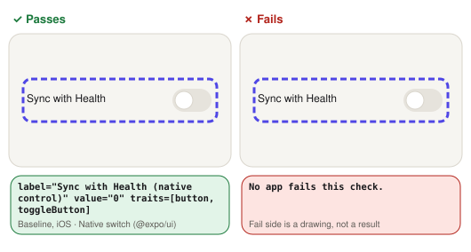

- **name, role, state:** Reads the control from the accessibility tree.
  - **Passes:** It has a label, the right role (button, switch, checkbox…) and its current state: disabled, busy, on/off, checked or selected.
  - **Fails:** Any of the three is missing or wrong, e.g. a switch read as just “Workout reminders”.

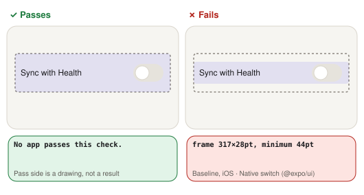

- **touch target:** Measures the control’s frame in the accessibility tree.
  - **Passes:** At least 44 × 44 pt on iOS (Apple’s default control size) and 48 × 48 dp on Android (Google’s minimum).
  - **Fails:** Either side is smaller, so it is easy to miss with a finger.

All checks, with their pictures: [Method](method.md#checks-in-pictures).

Why checks failed

- **Baseline**
  - iOS, touch target: 317×28pt
  - Android, touch target: 52×47.6dp
- **Unistyles**
  - iOS, touch target: 317×28pt
  - Android, touch target: 52×47.6dp
- **Uniwind**
  - iOS, touch target: 317×28pt
  - Android, touch target: 52×47.6dp
- **NativeWind**
  - iOS, touch target: 317×28pt
  - Android, touch target: 52×47.6dp
- **HeroUI**
  - iOS, touch target: 317×28pt
  - Android, touch target: 52×47.6dp
- **gluestack**
  - iOS, touch target: 317×28pt
  - Android, touch target: 52×47.6dp
- **Tamagui**
  - iOS, touch target: 317×28pt
  - Android, touch target: 52×47.6dp
- **Reusables**
  - iOS, touch target: 317×28pt
  - Android, touch target: 52×47.6dp

### Radio group

| Check | Baseline iOS / Android | Unistyles iOS / Android | Uniwind iOS / Android | NativeWind iOS / Android | HeroUI iOS / Android | gluestack iOS / Android | Tamagui iOS / Android | Reusables iOS / Android |
| --- | --- | --- | --- | --- | --- | --- | --- | --- |
| all options exposed | ✅ / ✅ | ✅ / ✅ | ✅ / ✅ | ✅ / ✅ | ✅ / ✅ | ✅ / ✅ | ✅ / ✅ | ✅ / ✅ |
| group label read | ✅ / ✅ | ✅ / ✅ | ✅ / ✅ | ✅ / ✅ | ✅ / ✅ | ✅ / ✅ | ✅ / ✅ | ✅ / ✅ |

What each check means

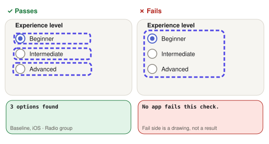

- **all options exposed:** Counts the radio options in the accessibility tree.
  - **Passes:** All three options are separate elements the screen reader can move to.
  - **Fails:** Fewer than three: options are merged into one element or missing.

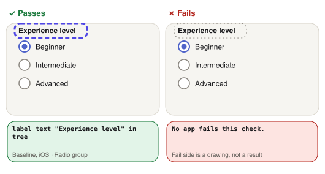

- **group label read:** Looks for the radio group’s label in the accessibility tree.
  - **Passes:** The label “Experience level” is in the tree.
  - **Fails:** It is drawn on screen but the screen reader can’t reach it.

All checks, with their pictures: [Method](method.md#checks-in-pictures).

No check failed for any app.

### Dialog

| Check | Baseline iOS / Android | Unistyles iOS / Android | Uniwind iOS / Android | NativeWind iOS / Android | HeroUI iOS / Android | gluestack iOS / Android | Tamagui iOS / Android | Reusables iOS / Android |
| --- | --- | --- | --- | --- | --- | --- | --- | --- |
| opens | ✅ / ✅ | ✅ / ✅ | ✅ / ✅ | ✅ / ✅ | ✅ / ✅ | ✅ / ✅ | ✅ / ✅ | ✅ / ✅ |
| screen behind is hidden from the screen reader | ✅ / ✅ | ✅ / ✅ | ✅ / ✅ | ✅ / ✅ | ❌ / ❌ | ❌ / ❌ | ❌ / ❌ | ❌ / ❌ |
| everything the screen reader lands on has a name | ✅ / ✅ | ✅ / ✅ | ✅ / ✅ | ✅ / ✅ | ✅ / ❌ ⚠️ | ✅ / ❌ ⚠️ | ✅ / ✅ | ✅ / ✅ |
| title is a heading | ✅ / ✅ | ✅ / ✅ | ✅ / ✅ | ✅ / ✅ | ✅ / ✅ | ✅ / ✅ | ✅ / ✅ | ❌ / ❌ |
| actions are buttons | ✅ / ✅ | ✅ / ✅ | ✅ / ✅ | ✅ / ✅ | ✅ / ✅ | ✅ / ✅ | ✅ / ✅ | ✅ / ✅ |
| closes | ✅ / ✅ | ✅ / ✅ | ✅ / ✅ | ✅ / ✅ | ✅ / ✅ | ✅ / ✅ | ✅ / ✅ | ✅ / ✅ |

What each check means

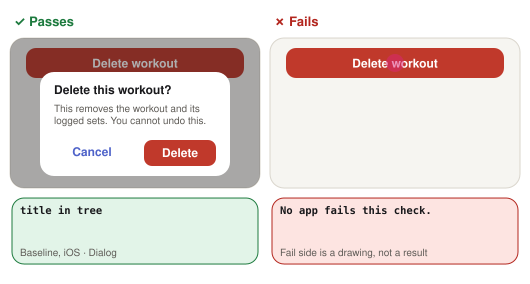

- **opens:** Taps the trigger and waits for the overlay’s content in the tree.
  - **Passes:** Its title or content appears.
  - **Fails:** Nothing appears in the tree after the tap.

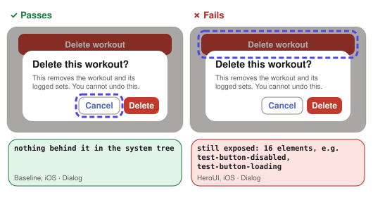

- **screen behind is hidden from the screen reader:** With the overlay open, lists every element the screen reader can reach.
  - **Passes:** Only the overlay’s own elements: nothing from the screen behind it.
  - **Fails:** Controls behind the overlay can still be reached, e.g. “Delete workout, button” behind the dialog.

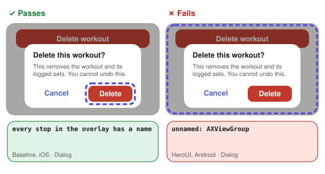

- **everything the screen reader lands on has a name:** With the overlay open, lists every element the screen reader can move to (each “stop”) and looks for any without a label.
  - **Passes:** Every one has a name.
  - **Fails:** At least one has none, e.g. a full-screen dimmed backdrop that TalkBack reads as “Unlabelled”.

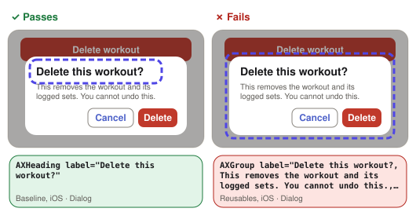

- **title is a heading:** Reads the dialog title’s role.
  - **Passes:** The title has the heading role, so it is read as “…, heading”.
  - **Fails:** It is read as plain text.

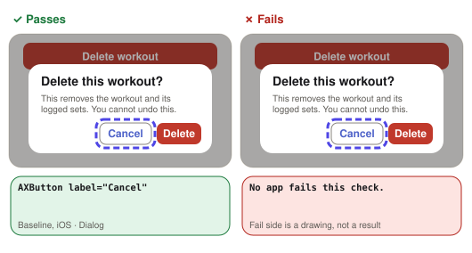

- **actions are buttons:** Reads the role of the dialog’s Cancel action.
  - **Passes:** It has the button role.
  - **Fails:** It is read as plain text, so the user isn’t told it can be activated.

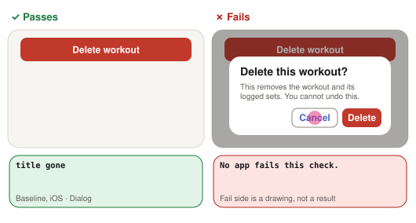

- **closes:** Taps the overlay’s own Close or Cancel button.
  - **Passes:** The overlay leaves the tree.
  - **Fails:** It is still open.

All checks, with their pictures: [Method](method.md#checks-in-pictures).

Why checks failed

- **HeroUI**
  - iOS, screen behind is hidden from the screen reader: still exposed: 16 elements, such as test-button-disabled, test-button-loading, Form
  - Android, screen behind is hidden from the screen reader: still exposed: 46 elements, such as test-sheet-close, Component test screen, test-theme
  - Android, everything the screen reader lands on has a name: unnamed: AXViewGroup 384×832dp
- **gluestack**
  - iOS, screen behind is hidden from the screen reader: still exposed: 19 elements, such as test-theme-0, test-theme-1, test-theme-2
  - Android, screen behind is hidden from the screen reader: still exposed: 45 elements, such as Component test screen, test-theme, test-theme-0
  - Android, everything the screen reader lands on has a name: unnamed: AXViewGroup 384×832dp
- **Tamagui**
  - iOS, screen behind is hidden from the screen reader: still exposed: 11 elements, such as Form, test-textfield, test-switch
  - Android, screen behind is hidden from the screen reader: still exposed: 45 elements, such as test-sheet-tamagui-close, Component test screen, test-theme-0
- **Reusables**
  - iOS, screen behind is hidden from the screen reader: still exposed: 18 elements, such as test-button-loading, Form, test-textfield
  - Android, screen behind is hidden from the screen reader: still exposed: 41 elements, such as Component test screen, test-theme-0, test-theme-1
  - iOS, title is a heading: AXGroup label="Delete this workout?, This removes the workout and its logged sets. You cannot undo this., Cancel, Delete"
  - Android, title is a heading: AXViewGroup label="Delete this workout?, This removes the workout and its logged sets. You cannot undo this."

### Select

| Check | Baseline iOS / Android | Unistyles iOS / Android | Uniwind iOS / Android | NativeWind iOS / Android | HeroUI iOS / Android | gluestack iOS / Android | Tamagui iOS / Android | Reusables iOS / Android |
| --- | --- | --- | --- | --- | --- | --- | --- | --- |
| opens | ✅ / ✅ | ✅ / ✅ | ✅ / ✅ | ✅ / ✅ | ✅ / ✅ | ✅ / ✅ | n/r / ✅ | ✅ / ✅ |
| current option marked | ✅ / ✅ | ✅ / ✅ | ✅ / ✅ | ✅ / ✅ | ✅ / ✅ | ❌ / ❌ | n/r / ✅ | ❌ / ✅ ⚠️ |
| options are actionable | ✅ / ✅ | ✅ / ✅ | ✅ / ✅ | ✅ / ✅ | ❌ / ❌ | ❌ / ❌ | n/r / ✅ | ❌ / ❌ |
| screen behind is hidden from the screen reader | ✅ / ✅ | ✅ / ✅ | ✅ / ✅ | ✅ / ✅ | ❌ / ❌ | ❌ / ❌ | n/r / ❌ | ✅ / ❌ ⚠️ |
| everything the screen reader lands on has a name | ✅ / ✅ | ✅ / ✅ | ✅ / ✅ | ✅ / ✅ | ✅ / ❌ ⚠️ | ✅ / ✅ | n/r / ✅ | ✅ / ❌ ⚠️ |
| new value read on trigger | ✅ / ✅ | ✅ / ✅ | ✅ / ✅ | ✅ / ✅ | ✅ / ✅ | ❌ / ❌ | n/r / ✅ | ✅ / ✅ |
| test could start | ✅ / ✅ | ✅ / ✅ | ✅ / ✅ | ✅ / ✅ | ✅ / ✅ | ✅ / ✅ | ❌ / ✅ ⚠️ | ✅ / ✅ |

What each check means

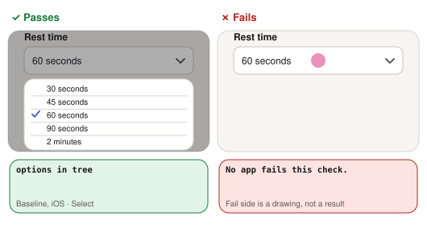

- **opens:** Taps the trigger and waits for the overlay’s content in the tree.
  - **Passes:** Its title or content appears.
  - **Fails:** Nothing appears in the tree after the tap.

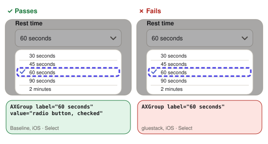

- **current option marked:** Opens the select and reads the option that is already chosen (60 seconds).
  - **Passes:** It is marked as selected or checked.
  - **Fails:** Nothing says which option is chosen.

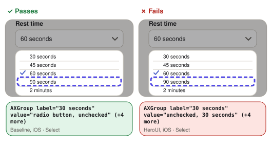

- **options are actionable:** Reads the role of every option in the open select.
  - **Passes:** Each has a button, radio or option role.
  - **Fails:** At least one is read as plain text.

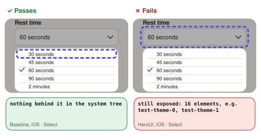

- **screen behind is hidden from the screen reader:** With the overlay open, lists every element the screen reader can reach.
  - **Passes:** Only the overlay’s own elements: nothing from the screen behind it.
  - **Fails:** Controls behind the overlay can still be reached, e.g. “Delete workout, button” behind the dialog.

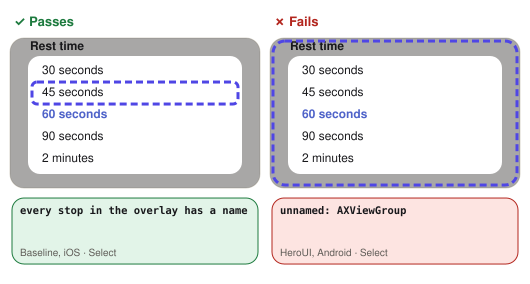

- **everything the screen reader lands on has a name:** With the overlay open, lists every element the screen reader can move to (each “stop”) and looks for any without a label.
  - **Passes:** Every one has a name.
  - **Fails:** At least one has none, e.g. a full-screen dimmed backdrop that TalkBack reads as “Unlabelled”.

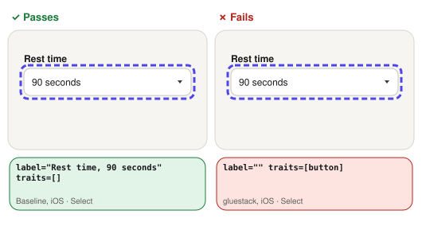

- **new value read on trigger:** Picks 90 seconds, then reads the select’s trigger.
  - **Passes:** The trigger reads the new value.
  - **Fails:** It still reads the old value, or no value.

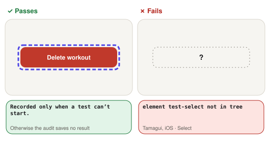

- **test could start:** Looks for the element the test starts from.
  - **Passes:** It was there, so the test’s other checks ran.
  - **Fails:** It wasn’t, so the test’s other checks are marked not run (n/r).

All checks, with their pictures: [Method](method.md#checks-in-pictures).

Why checks failed

- **HeroUI**
  - iOS, options are actionable: AXGroup label="30 seconds" value="unchecked, 30 seconds", and 4 more like it
  - Android, options are actionable: AXViewGroup label="30 seconds" value="unchecked", and 4 more like it
  - iOS, screen behind is hidden from the screen reader: still exposed: 16 elements, such as test-theme-0, test-theme-1, test-theme-2
  - Android, screen behind is hidden from the screen reader: still exposed: 45 elements, such as test-sheet-close, Component test screen, test-theme
  - Android, everything the screen reader lands on has a name: unnamed: AXViewGroup 384×832dp
- **gluestack**
  - iOS, current option marked: AXGroup label="60 seconds"
  - Android, current option marked: AXViewGroup label="60 seconds"
  - iOS, options are actionable: AXGroup label="30 seconds", and 4 more like it
  - Android, options are actionable: AXViewGroup label="30 seconds", and 4 more like it
  - iOS, screen behind is hidden from the screen reader: still exposed: 18 elements, such as test-theme-0, test-theme-1, test-theme-2
  - Android, screen behind is hidden from the screen reader: still exposed: 44 elements, such as Component test screen, test-theme, test-theme-0
  - iOS, new value read on trigger: label="" value="" traits=[button] 370×40pt
  - Android, new value read on trigger: label="" value="" traits=[button] 352×40dp
- **Tamagui**
  - Android, screen behind is hidden from the screen reader: still exposed: 44 elements, such as test-sheet-tamagui-close, Component test screen, test-theme-0
  - iOS, test could start: element test-select not in tree
- **Reusables**
  - iOS, current option marked: AXGroup label="60 seconds"
  - iOS, options are actionable: AXGroup label="30 seconds", and 4 more like it
  - Android, options are actionable: AXViewGroup label="30 seconds", and 4 more like it
  - Android, screen behind is hidden from the screen reader: still exposed: 40 elements, such as Component test screen, test-theme-0, test-theme-1
  - Android, everything the screen reader lands on has a name: unnamed: AXViewGroup 384×832dp

### Toast

| Check | Baseline iOS / Android | Unistyles iOS / Android | Uniwind iOS / Android | NativeWind iOS / Android | HeroUI iOS / Android | gluestack iOS / Android | Tamagui iOS / Android | Reusables iOS / Android |
| --- | --- | --- | --- | --- | --- | --- | --- | --- |
| screen reader can find it | ✅ / ✅ | ✅ / ✅ | ✅ / ✅ | ✅ / ✅ | ✅ / ✅ | ✅ / ✅ | ✅ / ✅ | ✅ / ✅ |

What each check means

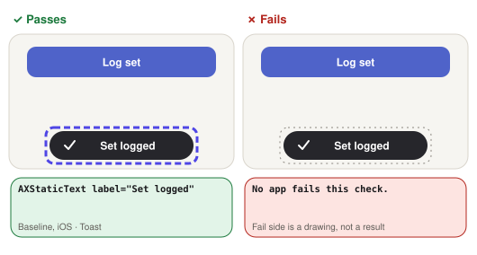

- **screen reader can find it:** Shows the toast and looks for its text in the tree within 3 s.
  - **Passes:** The toast is in the tree while it is on screen.
  - **Fails:** It is drawn but not in the tree, so the screen reader never finds it.

All checks, with their pictures: [Method](method.md#checks-in-pictures).

No check failed for any app.

### Slider

| Check | Baseline iOS / Android | Unistyles iOS / Android | Uniwind iOS / Android | NativeWind iOS / Android | HeroUI iOS / Android | gluestack iOS / Android | Tamagui iOS / Android | Reusables iOS / Android |
| --- | --- | --- | --- | --- | --- | --- | --- | --- |
| name, role, value | ✅ / ✅ | ✅ / ✅ | ✅ / ✅ | ✅ / ✅ | ❌ / ✅ ⚠️ | ❌ / ❌ | ❌ / ✅ ⚠️ | ✅ / ✅ |
| touch target | ✅ / ✅ | ✅ / ✅ | ✅ / ✅ | ✅ / ✅ | ❌ / ❌ | ❌ / ❌ | ❌ / ❌ | ✅ / ✅ |
| dragging changes the value | ✅ / ✅ | ✅ / ✅ | ✅ / ✅ | ✅ / ✅ | ✅ / ✅ | ❌ / ❌ | ✅ / ✅ | ✅ / ✅ |

What each check means

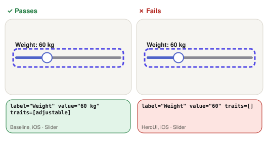

- **name, role, value:** Reads the slider from the accessibility tree.
  - **Passes:** It has a label, the adjustable role and its current value.
  - **Fails:** Any of the three is missing.

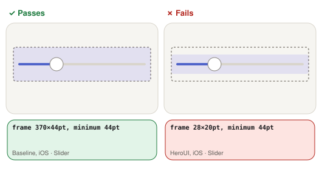

- **touch target:** Measures the control’s frame in the accessibility tree.
  - **Passes:** At least 44 × 44 pt on iOS (Apple’s default control size) and 48 × 48 dp on Android (Google’s minimum).
  - **Fails:** Either side is smaller, so it is easy to miss with a finger.

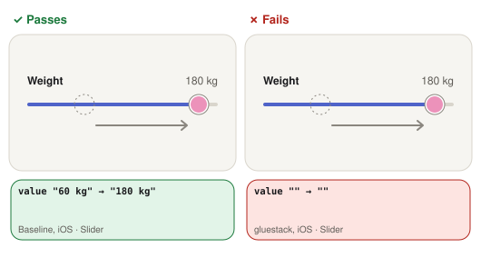

- **dragging changes the value:** Drags the thumb across the track and reads the value before and after. It stands in for the screen reader’s adjust gesture.
  - **Passes:** The value in the tree changes.
  - **Fails:** The value stays the same.

All checks, with their pictures: [Method](method.md#checks-in-pictures).

Why checks failed

- **HeroUI**
  - iOS, name, role, value: label="Weight" value="60" traits=[] 28×20pt (system tree)
  - iOS, touch target: 28×20pt (system tree, ±0.4 pt)
  - Android, touch target: 28×20dp
- **gluestack**
  - iOS, name, role, value: label="Slider" value="" traits=[] 370×6pt (system tree)
  - Android, name, role, value: label="Slider" value="" traits=[] 352×6dp
  - iOS, touch target: 370×6pt (system tree, ±0.4 pt)
  - Android, touch target: 352×6dp
  - iOS, dragging changes the value: value "" → ""
  - Android, dragging changes the value: value "" → ""
- **Tamagui**
  - iOS, name, role, value: label="Weight" value="30%" traits=[] 28×28pt
  - iOS, touch target: 28×28pt
  - Android, touch target: 28×28dp

### Progress

| Check | Baseline iOS / Android | Unistyles iOS / Android | Uniwind iOS / Android | NativeWind iOS / Android | HeroUI iOS / Android | gluestack iOS / Android | Tamagui iOS / Android | Reusables iOS / Android |
| --- | --- | --- | --- | --- | --- | --- | --- | --- |
| name and value | ✅ / ✅ | ✅ / ✅ | ✅ / ✅ | ✅ / ✅ | ✅ / ✅ | ❌ / ❌ | ✅ / ✅ | ❌ / ❌ |

What each check means

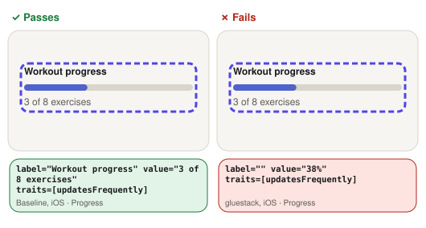

- **name and value:** Reads the progress bar from the accessibility tree.
  - **Passes:** It has a label and its current value.
  - **Fails:** The label or the value is missing.

All checks, with their pictures: [Method](method.md#checks-in-pictures).

Why checks failed

- **gluestack**
  - iOS, name and value: label="" value="38%" traits=[updatesFrequently] 370×8pt
  - Android, name and value: label="38%" value="" traits=[] role="Progress bar" 352×8dp
- **Reusables**
  - iOS, name and value: label="" value="0%" traits=[updatesFrequently] 370×8pt
  - Android, name and value: label="0%" value="0" traits=[] role="Progress bar" 352×8dp

### Accordion

| Check | Baseline iOS / Android | Unistyles iOS / Android | Uniwind iOS / Android | NativeWind iOS / Android | HeroUI iOS / Android | gluestack iOS / Android | Tamagui iOS / Android | Reusables iOS / Android |
| --- | --- | --- | --- | --- | --- | --- | --- | --- |
| header is a button | ✅ / ✅ | ✅ / ✅ | ✅ / ✅ | ✅ / ✅ | ✅ / ✅ | ✅ / ✅ | ❌ / ❌ | ✅ / ✅ |
| touch target | ✅ / ✅ | ✅ / ✅ | ✅ / ✅ | ✅ / ✅ | ✅ / ✅ | ❌ / ❌ | n/r / ✅ | ✅ / ✅ |
| expanded state exposed | ✅ / ✅ | ✅ / ✅ | ✅ / ✅ | ✅ / ✅ | ✅ / ✅ | ✅ / ✅ | n/r / ✅ | ✅ / ✅ |
| content shows and hides | ✅ / ✅ | ✅ / ✅ | ✅ / ✅ | ✅ / ✅ | ✅ / ✅ | ✅ / ✅ | n/r / ✅ | ✅ / ✅ |
| test could start | ✅ / ✅ | ✅ / ✅ | ✅ / ✅ | ✅ / ✅ | ✅ / ✅ | ✅ / ✅ | ❌ / ✅ ⚠️ | ✅ / ✅ |

What each check means

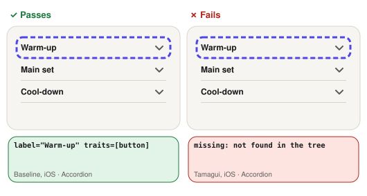

- **header is a button:** Reads the role of the accordion’s first header.
  - **Passes:** It has the button role.
  - **Fails:** It is read as plain text.

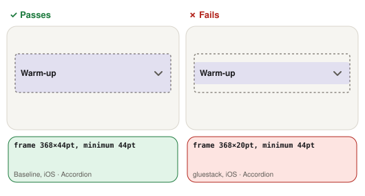

- **touch target:** Measures the control’s frame in the accessibility tree.
  - **Passes:** At least 44 × 44 pt on iOS (Apple’s default control size) and 48 × 48 dp on Android (Google’s minimum).
  - **Fails:** Either side is smaller, so it is easy to miss with a finger.

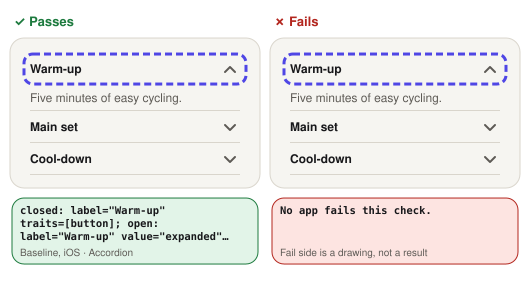

- **expanded state exposed:** Reads the header closed, taps it, and reads it open.
  - **Passes:** It reads as expanded when open and not when closed.
  - **Fails:** It reads the same either way.

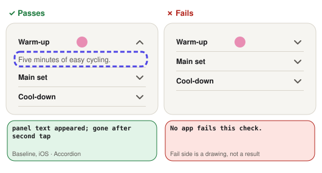

- **content shows and hides:** Taps the header twice, looking for the section text after each tap.
  - **Passes:** The text appears on the first tap and goes on the second.
  - **Fails:** It doesn’t appear, or doesn’t go.

- **test could start:** Looks for the element the test starts from.
  - **Passes:** It was there, so the test’s other checks ran.
  - **Fails:** It wasn’t, so the test’s other checks are marked not run (n/r).

All checks, with their pictures: [Method](method.md#checks-in-pictures).

Why checks failed

- **gluestack**
  - iOS, touch target: 368×20pt
  - Android, touch target: 350×20dp
- **Tamagui**
  - iOS, header is a button: missing
  - Android, header is a button: label="Warm-up, ▾" value="collapsed" traits=[] 99×53dp
  - iOS, test could start: element test-accordion-0 not in tree

### Menu

| Check | Baseline iOS / Android | Unistyles iOS / Android | Uniwind iOS / Android | NativeWind iOS / Android | HeroUI iOS / Android | gluestack iOS / Android | Tamagui iOS / Android | Reusables iOS / Android |
| --- | --- | --- | --- | --- | --- | --- | --- | --- |
| trigger name and role | ✅ / ✅ | ✅ / ✅ | ✅ / ✅ | ✅ / ✅ | ✅ / ✅ | ✅ / ✅ | ✅ / ✅ | ✅ / ✅ |
| touch target | ✅ / ✅ | ✅ / ✅ | ✅ / ✅ | ✅ / ✅ | ✅ / ✅ | ❌ / ❌ | ✅ / ✅ | ❌ / ❌ |
| opens | ✅ / ✅ | ✅ / ✅ | ✅ / ✅ | ✅ / ✅ | ✅ / ✅ | ✅ / ✅ | ✅ / ✅ | ✅ / ✅ |
| items are buttons | ✅ / ✅ | ✅ / ✅ | ✅ / ✅ | ✅ / ✅ | ❌ / ✅ ⚠️ | ❌ / ✅ ⚠️ | ✅ / ❌ ⚠️ | ❌ / ✅ ⚠️ |
| screen behind is hidden from the screen reader | ✅ / ✅ | ✅ / ✅ | ✅ / ✅ | ✅ / ✅ | ❌ / ❌ | ❌ / ❌ | ❌ / ✅ ⚠️ | ✅ / ❌ ⚠️ |
| everything the screen reader lands on has a name | ✅ / ✅ | ✅ / ✅ | ✅ / ✅ | ✅ / ✅ | ✅ / ❌ ⚠️ | ✅ / ❌ ⚠️ | ✅ / ✅ | ✅ / ❌ ⚠️ |
| closes after an action | ✅ / ✅ | ✅ / ✅ | ✅ / ✅ | ✅ / ✅ | ✅ / ✅ | ✅ / ✅ | ✅ / ✅ | ✅ / ✅ |

What each check means

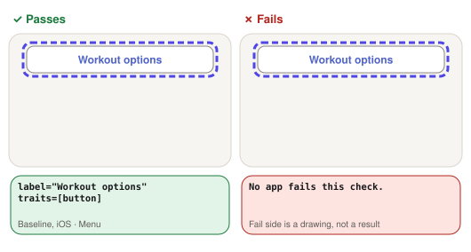

- **trigger name and role:** Reads the menu button from the accessibility tree.
  - **Passes:** It has a label and the button role.
  - **Fails:** The label or the role is missing.

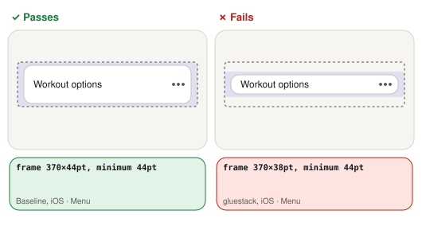

- **touch target:** Measures the control’s frame in the accessibility tree.
  - **Passes:** At least 44 × 44 pt on iOS (Apple’s default control size) and 48 × 48 dp on Android (Google’s minimum).
  - **Fails:** Either side is smaller, so it is easy to miss with a finger.

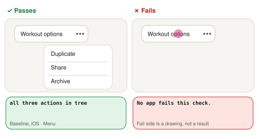

- **opens:** Taps the trigger and waits for the overlay’s content in the tree.
  - **Passes:** Its title or content appears.
  - **Fails:** Nothing appears in the tree after the tap.

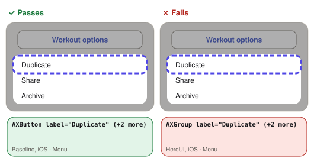

- **items are buttons:** Reads the role of each menu action.
  - **Passes:** Each has the button role.
  - **Fails:** At least one is read as plain text.

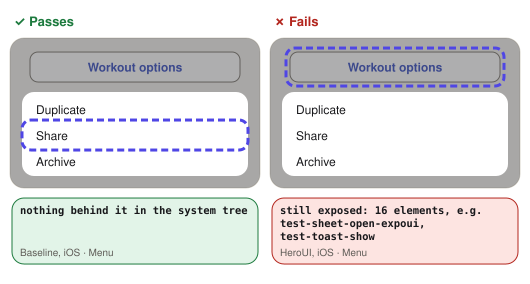

- **screen behind is hidden from the screen reader:** With the overlay open, lists every element the screen reader can reach.
  - **Passes:** Only the overlay’s own elements: nothing from the screen behind it.
  - **Fails:** Controls behind the overlay can still be reached, e.g. “Delete workout, button” behind the dialog.

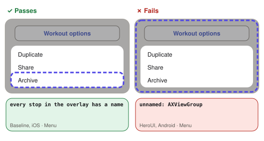

- **everything the screen reader lands on has a name:** With the overlay open, lists every element the screen reader can move to (each “stop”) and looks for any without a label.
  - **Passes:** Every one has a name.
  - **Fails:** At least one has none, e.g. a full-screen dimmed backdrop that TalkBack reads as “Unlabelled”.

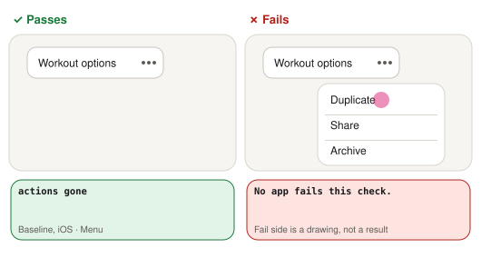

- **closes after an action:** Taps the first menu action.
  - **Passes:** The menu leaves the tree.
  - **Fails:** It is still open.

All checks, with their pictures: [Method](method.md#checks-in-pictures).

Why checks failed

- **HeroUI**
  - iOS, items are buttons: AXGroup label="Duplicate", and 2 more like it
  - iOS, screen behind is hidden from the screen reader: still exposed: 16 elements, such as test-sheet-open-expoui, test-toast-show, Tabs
  - Android, screen behind is hidden from the screen reader: still exposed: 45 elements, such as test-sheet-close, Component test screen, test-theme
  - Android, everything the screen reader lands on has a name: unnamed: AXViewGroup 384×832dp
- **gluestack**
  - iOS, touch target: 370×38pt
  - Android, touch target: 352×38dp
  - iOS, items are buttons: AXGroup label="Duplicate", and 2 more like it
  - iOS, screen behind is hidden from the screen reader: still exposed: 17 elements, such as test-dialog-open, test-sheet-open, test-sheet-open-expoui
  - Android, screen behind is hidden from the screen reader: still exposed: 44 elements, such as Component test screen, test-theme, test-theme-0
  - Android, everything the screen reader lands on has a name: unnamed: AXViewGroup 352×6dp, AXViewGroup 210×140dp
- **Tamagui**
  - Android, items are buttons: AXView label="Duplicate", and 2 more like it
  - iOS, screen behind is hidden from the screen reader: still exposed: 14 elements, such as test-sheet-open, test-sheet-open-tamagui, test-sheet-open-expoui
- **Reusables**
  - iOS, touch target: 370×40pt
  - Android, touch target: 352×40dp
  - iOS, items are buttons: AXGroup label="Duplicate", and 2 more like it
  - Android, screen behind is hidden from the screen reader: still exposed: 40 elements, such as Component test screen, test-theme-0, test-theme-1
  - Android, everything the screen reader lands on has a name: unnamed: AXViewGroup 384×832dp, AXView#test-menu 224×119dp

### Segmented control

| Check | Baseline iOS / Android | Unistyles iOS / Android | Uniwind iOS / Android | NativeWind iOS / Android | HeroUI iOS / Android | gluestack iOS / Android | Tamagui iOS / Android | Reusables iOS / Android |
| --- | --- | --- | --- | --- | --- | --- | --- | --- |
| options have name and role | ✅ / ✅ | ✅ / ✅ | ✅ / ✅ | ✅ / ✅ | ✅ / ✅ | ✅ / ✅ | ❌ / ❌ | ✅ / ✅ |
| selected option marked | ✅ / ✅ | ✅ / ✅ | ✅ / ✅ | ✅ / ✅ | ✅ / ✅ | ✅ / ✅ | ❌ / ❌ | ✅ / ✅ |
| touch target | ✅ / ✅ | ✅ / ✅ | ✅ / ✅ | ✅ / ✅ | ✅ / ✅ | ✅ / ✅ | ✅ / ✅ | ❌ / ❌ |
| selection moves on tap | ✅ / ✅ | ✅ / ✅ | ✅ / ✅ | ✅ / ✅ | ✅ / ✅ | ✅ / ✅ | ❌ / ❌ | ✅ / ✅ |

What each check means

- **options have name and role:** Reads each segment of the segmented control.
  - **Passes:** Each has a label and a button, radio or tab role.
  - **Fails:** A label or role is missing.

- **selected option marked:** Reads every segment’s state.
  - **Passes:** The selected one is marked as selected or checked, and the others aren’t.
  - **Fails:** Nothing says which is selected.

- **touch target:** Measures the control’s frame in the accessibility tree.
  - **Passes:** At least 44 × 44 pt on iOS (Apple’s default control size) and 48 × 48 dp on Android (Google’s minimum).
  - **Fails:** Either side is smaller, so it is easy to miss with a finger.

- **selection moves on tap:** Taps the second segment and reads the states again.
  - **Passes:** The selected state moves to it.
  - **Fails:** It stays on the first, or isn’t marked at all.

All checks, with their pictures: [Method](method.md#checks-in-pictures).

Why checks failed

- **Tamagui**
  - iOS, options have name and role: label="Week" value="" traits=[] 123×44pt, and 2 more like it
  - Android, options have name and role: label="Week" value="" traits=[] 117×48dp, and 2 more like it
  - iOS, selected option marked: label="Week" value="" traits=[] 123×44pt, and 2 more like it
  - Android, selected option marked: label="Week" value="" traits=[] 117×48dp, and 2 more like it
  - iOS, selection moves on tap: label="Week" value="" traits=[] 123×44pt | label="Month" value="" traits=[] 123×44pt
  - Android, selection moves on tap: label="Week" value="" traits=[] 117×48dp | label="Month" value="" traits=[] 117×48dp
- **Reusables**
  - iOS, touch target: 124×40pt
  - Android, touch target: 118×40dp

### Bottom sheets

Each sheet gets the same 5 checks: opens, title and body readable, screen behind is hidden from the screen reader, closes, screen reachable again after close. Each cell is the number passed, iOS / Android: ✅ all passed, ❌ at least one failed, ➖ the app has no such sheet.

| Sheet | Baseline iOS / Android | Unistyles iOS / Android | Uniwind iOS / Android | NativeWind iOS / Android | HeroUI iOS / Android | gluestack iOS / Android | Tamagui iOS / Android | Reusables iOS / Android |
| --- | --- | --- | --- | --- | --- | --- | --- | --- |
| @gorhom/bottom-sheet | ❌ 4/5 / ❌ 4/5 | ❌ 4/5 / ❌ 4/5 | ❌ 4/5 / ❌ 4/5 | ❌ 4/5 / ❌ 4/5 | ❌ 3/5 / ❌ 3/5 | ❌ 4/5 / ❌ 4/5 | ❌ 4/5 / ❌ 4/5 | ❌ 4/5 / ❌ 4/5 |
| @expo/ui BottomSheet | ✅ 5/5 / ✅ 5/5 | ✅ 5/5 / ✅ 5/5 | ✅ 5/5 / ✅ 5/5 | ✅ 5/5 / ✅ 5/5 | ✅ 5/5 / ✅ 5/5 | ✅ 5/5 / ✅ 5/5 | ✅ 5/5 / ✅ 5/5 | ✅ 5/5 / ✅ 5/5 |
| The library’s own sheet | ➖ / ➖ | ➖ / ➖ | ➖ / ➖ | ➖ / ➖ | ❌ 3/5 / ❌ 3/5 | ❌ 1/4 / ❌ 1/4 | ❌ 4/5 / ❌ 4/5 | ➖ / ➖ |

The three sheets

- **@gorhom/bottom-sheet:** the raw third-party sheet, themed with the library’s tokens
- **@expo/ui BottomSheet:** the native sheet, filled with @expo/ui’s own Text and Button
- **The library’s own sheet:** the sheet component the library ships, set up as its docs show

What each check means

- **opens:** Taps the trigger and waits for the overlay’s content in the tree.
  - **Passes:** Its title or content appears.
  - **Fails:** Nothing appears in the tree after the tap.

- **title and body readable:** Looks for the sheet’s title and body text in the tree.
  - **Passes:** Both are in the tree.
  - **Fails:** The text is drawn but the screen reader can’t reach it.

- **screen behind is hidden from the screen reader:** With the overlay open, lists every element the screen reader can reach.
  - **Passes:** Only the overlay’s own elements: nothing from the screen behind it.
  - **Fails:** Controls behind the overlay can still be reached, e.g. “Delete workout, button” behind the dialog.

- **closes:** Taps the overlay’s own Close or Cancel button.
  - **Passes:** The overlay leaves the tree.
  - **Fails:** It is still open.

- **screen reachable again after close:** After the sheet closes, looks for the screen’s controls in the tree.
  - **Passes:** They are back, so the screen reader can use the screen again.
  - **Fails:** They are still hidden, as if the sheet were open.

All checks, with their pictures: [Method](method.md#checks-in-pictures).

Why checks failed

- **Baseline**
  - @gorhom/bottom-sheet, iOS, screen behind is hidden from the screen reader: still exposed: 15 elements, such as test-button-disabled, test-button-loading, Form
  - @gorhom/bottom-sheet, Android, screen behind is hidden from the screen reader: still exposed: 44 elements, such as Component test screen, test-theme, test-theme-0
- **Unistyles**
  - @gorhom/bottom-sheet, iOS, screen behind is hidden from the screen reader: still exposed: 15 elements, such as test-button-disabled, test-button-loading, Form
  - @gorhom/bottom-sheet, Android, screen behind is hidden from the screen reader: still exposed: 44 elements, such as Component test screen, test-theme, test-theme-0
- **Uniwind**
  - @gorhom/bottom-sheet, iOS, screen behind is hidden from the screen reader: still exposed: 15 elements, such as test-button-disabled, test-button-loading, Form
  - @gorhom/bottom-sheet, Android, screen behind is hidden from the screen reader: still exposed: 44 elements, such as Component test screen, test-theme, test-theme-0
- **NativeWind**
  - @gorhom/bottom-sheet, iOS, screen behind is hidden from the screen reader: still exposed: 15 elements, such as test-button-disabled, test-button-loading, Form
  - @gorhom/bottom-sheet, Android, screen behind is hidden from the screen reader: still exposed: 44 elements, such as Component test screen, test-theme, test-theme-0
- **HeroUI**
  - @gorhom/bottom-sheet, iOS, title and body readable: title and body text not in the system tree
  - @gorhom/bottom-sheet, iOS, screen behind is hidden from the screen reader: still exposed: 16 elements, such as test-button-disabled, test-button-loading, Form
  - @gorhom/bottom-sheet, Android, title and body readable: title and body text not in the system tree
  - @gorhom/bottom-sheet, Android, screen behind is hidden from the screen reader: still exposed: 46 elements, such as test-sheet-close, Component test screen, test-theme
  - The library’s own sheet, iOS, title and body readable: title and body text not in the system tree
  - The library’s own sheet, iOS, screen behind is hidden from the screen reader: still exposed: 16 elements, such as test-button-disabled, test-button-loading, Form
  - The library’s own sheet, Android, title and body readable: title and body text not in the system tree
  - The library’s own sheet, Android, screen behind is hidden from the screen reader: still exposed: 45 elements, such as Component test screen, test-theme, test-theme-0
- **gluestack**
  - @gorhom/bottom-sheet, iOS, screen behind is hidden from the screen reader: still exposed: 19 elements, such as test-button-loading, Form, test-textfield
  - @gorhom/bottom-sheet, Android, screen behind is hidden from the screen reader: still exposed: 45 elements, such as Component test screen, test-theme, test-theme-0
  - The library’s own sheet, iOS, title and body readable: title and body text not in the system tree
  - The library’s own sheet, iOS, screen behind is hidden from the screen reader: still exposed: 19 elements, such as test-button-loading, Form, test-textfield
  - The library’s own sheet, iOS, closes: still open
  - The library’s own sheet, Android, title and body readable: title and body text not in the system tree
  - The library’s own sheet, Android, screen behind is hidden from the screen reader: still exposed: 45 elements, such as Component test screen, test-theme, test-theme-0
  - The library’s own sheet, Android, closes: still open
- **Tamagui**
  - @gorhom/bottom-sheet, iOS, screen behind is hidden from the screen reader: still exposed: 11 elements, such as Form, test-textfield, test-switch
  - @gorhom/bottom-sheet, Android, screen behind is hidden from the screen reader: still exposed: 45 elements, such as test-sheet-tamagui-close, Component test screen, test-theme-0
  - The library’s own sheet, iOS, screen behind is hidden from the screen reader: still exposed: 15 elements, such as test-textfield, test-switch, test-radiogroup-0
  - The library’s own sheet, Android, screen behind is hidden from the screen reader: still exposed: 44 elements, such as Component test screen, test-theme-0, test-theme-1
- **Reusables**
  - @gorhom/bottom-sheet, iOS, screen behind is hidden from the screen reader: still exposed: 18 elements, such as test-button-loading, Form, test-textfield
  - @gorhom/bottom-sheet, Android, screen behind is hidden from the screen reader: still exposed: 41 elements, such as Component test screen, test-theme-0, test-theme-1

## Dark and brand themes

Every check also ran in the dark and brand themes, on both platforms. The tables above show light.

- **No check changed:** every check gave the same result in the dark and brand themes as in light, on both platforms.

## Charts

### Accessibility

**Measured on** iOS: iPhone 17 simulator (iOS 27.0). Android: Galaxy A15 5G (Android 16).

**How to read it:**

- The baseline and the three styling engines share the same hand-built components. Their bars are what careful hand-built accessibility reaches.
- A library’s gap to them is what you would have to fix yourself.

**Measured on** iOS: iPhone 17 simulator (iOS 27.0). Android: Galaxy A15 5G (Android 16).

**How to read it:**

- Sheets: @expo/ui in every app, Tamagui’s and gluestack’s own, and a raw @gorhom sheet in HeroUI.

### Speed, memory and scrolling

Compare apps within a platform. iOS is an iPhone 12 Pro, Android a budget Galaxy A15.

**Measured on** iOS: iPhone 12 Pro (iOS 26.6.1). Android: Galaxy A15 5G (Android 16).

**How to read it:**

- iOS: five apps take two frames (about 33 ms), gluestack and HeroUI about 65 ms, Tamagui 116 ms.
- Android: Tamagui (630 ms) stands out, then HeroUI (239 ms).
- The other gaps are within each app’s run-to-run spread.

**Measured on** iOS: iPhone 12 Pro (iOS 26.6.1). Android: Galaxy A15 5G (Android 16).

**How to read it:**

- iOS: 94–102 ms in most apps, NativeWind 118 ms and Tamagui 135 ms.
- Android: most apps take 150–180 ms, with overlapping ranges. Tamagui takes 365 ms.

**Measured on** iOS: iPhone 12 Pro (iOS 26.6.1). Android: Galaxy A15 5G (Android 16).

**How to read it:**

- Within each platform the apps sit close together, so read them as groups.
- iOS: 1.2–1.3 s in every app, which is within one poll of the accessibility tree (about 0.5 s), so they can’t be told apart.
- Android: 2.8–3.5 s, with the component libraries at the slow end.

**Measured on** iOS: iPhone 12 Pro (iOS 26.6.1). Android: Galaxy A15 5G (Android 16).

**How to read it:**

- Compare apps within a platform, not across: the two are different measures.
- On both, the component libraries use more than the baseline, and HeroUI the most.

**Measured on** iOS: iPhone 12 Pro (iOS 26.6.1). Android: Galaxy A15 5G (Android 16).

**How to read it:**

- iOS: Tamagui (144 MiB) stands out.
- Android: HeroUI (416 MiB) and gluestack (286 MiB) grow far more than the rest.

**Measured on** iOS: iPhone 12 Pro (iOS 26.6.1). Android: Galaxy A15 5G (Android 16).

**How to read it:**

- Compare apps within a platform: on the iPhone each fling is injected by XCUITest, which spreads the 5 over about 27 s and adds its own work.
- Tamagui uses the most on iOS, HeroUI on Android, and each is second on the other.

**Measured on** iOS: iPhone 12 Pro (iOS 26.6.1). Android: Galaxy A15 5G (Android 16).

**How to read it:**

- At most 1 in any app on either phone, so scrolling is smooth everywhere.

### Bundle size and re-renders

**Measured on** no device, built with expo export.

**How to read it:**

- Exact, with no run-to-run noise.
- The baseline is plain React Native, so the gap to it is what the library adds.

**Measured on** iOS: iPhone 17 simulator (iOS 27.0). Android: Galaxy A15 5G (Android 16).

**How to read it:**

- Unistyles re-renders the fewest on both platforms, HeroUI and Tamagui the most.
- Tamagui has Android counts only: its Debug build aborts on iOS. A closed Select keeps a hidden `display: none` view, which trips an open React Native bug, [react-native#52349](https://github.com/react/react-native/issues/52349). Release builds aren’t affected.

<!-- begin:navfoot -->

---

← [Back to README](../README.md)
<!-- end:navfoot -->
