<a id="method"></a>

# Method

<!-- begin:nav -->
**The docs:**

- [README](../README.md): the answer, the scorecard and each library
- [Site](https://asmalik107.github.io/am-ui-lab/): the scorecard, every check and the charts, sortable and filterable
- [Results](results.md): every check, with the iOS and Android numbers
- **Method** (this page): how each check was measured, its limits, and how to reproduce it
- [iOS accessibility](ios-accessibility.md): every iOS accessibility failure, with the line of code that causes it
- [Android accessibility](android-accessibility.md): every Android accessibility failure, with the line of code that causes it
- [All checks](checks.md): every accessibility check for every app, one table per component, plus the charts
- [To do](../TODO.md): what is left to measure, and how
<!-- end:nav -->

How every number in [Results](results.md) was measured.

- **Same screen:** every library builds the same screen to the same spec.
- **Same checks:** every app goes through the same scripted checks.
- **Measured only:** a result is recorded only if it was measured. Anything else is marked `not tested`, with the reason.

<a id="contents"></a>

## Contents

- [Why one app per library](#why-one-app-per-library)
- [Pinned stack](#pinned-stack)
- [The test screen](#the-test-screen)
- [iOS and Android](#ios-and-android)
- [Accessibility checks](#accessibility-checks)
  - [Checks in pictures](#checks-in-pictures)
- [Performance checks](#performance-checks)
- [Ease-of-use log](#ease-of-use-log)
- [Limits](#limits)
- [Reproduce](#reproduce)

<a id="why-one-app-per-library"></a>

## Why one app per library

- **Most of these libraries change global config:** a Babel plugin, a compiler, or Tailwind/CSS processing in Metro.
- **In one app they would interfere** with each other and skew the bundle-size and render measurements.
- **So each library gets its own Expo app** under `apps/<library>`, with identical Expo, React Native and Reanimated versions.

<a id="pinned-stack"></a>

## Pinned stack

| Package | Version |
| --- | --- |
| expo | ~57.0.31 |
| react-native | 0.86.3 |
| react | 19.2.3 |
| react-native-reanimated | 4.5.1 |
| react-native-worklets | 0.10.1 |
| expo-router | ~57.0.29 |

- **New Architecture:** on, the default in SDK 57.
- **Builds:** every app runs as a development build, not in Expo Go.

<a id="the-test-screen"></a>

## The test screen

- **Library components first:** each app uses the library's own component where it has one.
- **Otherwise hand-built:** the app uses the library's styling or theming API on React Native primitives.
- **Which is which:** each app's `NOTES.md` says, item by item.

| # | Component | Must support |
| --- | --- | --- |
| 1 | Button | Pressed, disabled and loading states |
| 2 | Text field | Visible label, helper text, error message |
| 3 | Switch | Labelled |
| 4 | Checkbox | Labelled, including an indeterminate state if the library has one |
| 5 | Radio group | Three options, group label |
| 6 | Modal dialog | Title, body, confirm/cancel |
| 7 | Bottom sheet | Opened from a button |
| 8 | Menu / select | Five options |
| 9 | Tabs | Three tabs |
| 10 | Toast | Shown after a button press |
| 11 | List | 200 themed rows (title, subtitle, icon) |
| 12 | Theme switcher | Light, dark, and a third brand theme |
| 13 | Third-party component | `@gorhom/bottom-sheet` themed with the library's tokens |
| 14 | Native component | An `@expo/ui` control placed next to the library's components and themed with its tokens |
| 15 | Slider | Labelled, value announced, adjustable (weight 0–200 kg, step 2.5) |
| 16 | Progress | Labelled, with a value (workout 3 of 8) |
| 17 | Accordion | Three sections, expanded/collapsed state |
| 18 | Menu / popover | Opened from a button, three actions |
| 19 | Segmented control | Three options, selected state |

- **Items 15–19** were added on 27 October 2026.
- **Test IDs and copy:** `shared/content.ts`.
- **Tokens:** every app uses the same colours, spacing, radii and type scale, from `packages/tokens`.

<a id="ios-and-android"></a>

## iOS and Android

- **Same everything:** every check runs on both platforms with the same script, flows and check names.
- **Two values per result:** one for iOS, one for Android.
- **Each platform's own rules:** where a platform has its own guideline or setting, it is held to its own.

| What | iOS | Android |
| --- | --- | --- |
| Device | Performance: iPhone 12 Pro, iOS 26.6.1, by cable. Everything else: iPhone 17 simulator, iOS 27.0 | Samsung Galaxy A15 5G (SM-A156E), Android 16. A physical budget phone; the Android emulator crashed repeatedly on this Mac. |
| Accessibility tree | What VoiceOver is given: the system accessibility tree (argent `describe`) and the view hierarchy (argent `native-describe-screen`) | What TalkBack is given: the active window's accessibility tree, read through UiAutomation by `scripts/android-a11y-dump`. A tappable element with no label of its own is named by the text inside it, as TalkBack does. A label linked with `aria-labelledby` (`labeledBy`) is added after an element’s own description (for a text field, it comes first, because the field’s own text is its value), and a focusable container (React Native’s `accessible`) counts as one stop, as TalkBack reads it. These were added on 2 and 4 November 2026; they moved 7 checks in HeroUI, gluestack and Reusables. Also from 4 November 2026: a loading button’s name must include its text (“Saving”), not only a busy word, and every overlay is checked for stops with no name, which TalkBack reads as “Unlabelled”. On Android a dialog’s title is the stop named exactly the title, since a container named by `aria-labelledby` also includes it (HeroUI’s dialog, heard “Delete this workout?, Heading”). TalkBack’s own words were checked by hand: `am instrument -w -e focus <testID> dev.asimmalik.uilab.a11ydump/.Dump` moves TalkBack’s focus to an element, and TalkBack’s developer setting Display speech output shows what it says. |
| Role and state | VoiceOver traits (button, adjustable, header, selected, not enabled) | Class and role description (Button, Switch, CheckBox, RadioButton, SeekBar, "Combo box", "Tab"), heading, checked, selected, enabled, state description, expand and collapse actions |
| Screen hidden behind an overlay | Nothing from the screen is in the system tree while the overlay is open | Nothing from the screen is in the active window while the overlay is open |
| Touch target | ≥ 44 × 44 pt (Apple's default control size) | ≥ 48 × 48 dp (Google's minimum) |
| Largest text size | AX5 (accessibility-extra-extra-extra-large) | Font scale 2.0, the largest Android offers. Android 14+ scales large text less than small text. |
| Pushed off screen at the largest size | Frame outside the screen | Present at the default size but gone from the tree, or newly touching the screen edge (Android clips bounds to the screen) |
| Reduced motion | Reduce Motion on, set before launch | Remove animations (animator, transition and window scales 0), set before launch. Restored afterwards. |
| Recording for motion | Simulator recording at 30 fps | Phone recording, resampled to 30 fps |
| Timings, startup, CPU | iPhone 12 Pro | Budget phone; compare apps within a platform |
| Memory | phys_footprint, from Instruments' Activity Monitor on the phone | `dumpsys meminfo` total PSS. A different measure, so compare apps within a platform. |
| Scrolling | CPU during 5 flings and frame hitches (Instruments' Animation Hitches) | CPU during 5 flings (from `/proc`) and janky frames (`dumpsys gfxinfo`) |
| Bundle size | `expo export --platform ios` | `expo export --platform android` |
| Re-renders | iPhone 17 simulator, Debug build with Metro | Galaxy A15, Debug build with Metro over `adb reverse` |

**Don't compare memory or speed across platforms.**

- iOS is a 2020 flagship, the iPhone 12 Pro
- Android is a 2023 budget phone
- Memory is measured differently on each
- Compare the apps within each platform, and how each app ranks on the two

**Run everything:**

- iOS: `scripts/run-all.sh <udid>`
- Android: `scripts/run-all-android.sh <serial>`

<a id="accessibility-checks"></a>

## Accessibility checks

| Check | Pass condition | Reference |
| --- | --- | --- |
| Name, role, value | Every control exposes a label, the correct role, and its state: checked, selected, expanded, disabled or busy | WCAG 2.2 SC 4.1.2 |
| Focus on modal open | Focus moves into the dialog or sheet, background content is hidden from assistive technology, and focus returns to the trigger on close | WCAG 2.2 SC 2.4.3; RN `aria-modal`/`accessibilityViewIsModal` (iOS-only) and `importantForAccessibility` (Android) |
| Announcements | Form errors and toasts are announced. Live regions (`aria-live`) are Android-only in React Native, so iOS needs `AccessibilityInfo.announceForAccessibility` | WCAG 2.2 SC 4.1.3 (AA) |
| Text scaling | At the largest accessibility text size, nothing is clipped, overlapping or truncated without a way to read it | WCAG 2.2 SC 1.4.4; Apple Dynamic Type |
| Reduce Motion | With Reduce Motion (iOS) or Remove animations (Android) on at launch, the dialog and sheet open without their animation. Switching it on while the app runs isn't tested | WCAG 2.2 SC 2.3.3 (AAA, not AA); Apple HIG |
| Touch targets | At least 44×44pt on iOS (Apple's default control size; 28pt is its minimum) and 48×48dp on Android, measured from accessibility-tree frames | Apple HIG; Material; WCAG 2.2 SC 2.5.8 (24px at AA) |
| Contrast | The default theme's text/background token pairs meet 4.5:1 (3:1 for large text and UI components) | WCAG 2.2 SC 1.4.3, 1.4.11 |

**Every accessibility check runs three times:** in the light, dark and brand themes (`scripts/a11y-audit.mjs --theme`).

**Checks for items 15–19:**

| Item | Checks |
| --- | --- |
| Slider | Name, `adjustable` role and value; touch target; dragging the thumb changes the value. The screen reader's own adjust gesture needs it running, so the drag stands in for it on both platforms. |
| Progress | Name and value |
| Accordion | Header is a button; its expanded state is exposed; content appears and disappears |
| Menu | Trigger name and role; touch target; opens; items are buttons; screen behind hidden; closes after an action |
| Segmented control | Each option has a name and role; the selected one is marked; touch target; selection moves on tap |

**Not covered.** The scripts read what each screen reader is given, not what it says. So these aren't tested:

- What VoiceOver and TalkBack actually speak
- Swipe order, as heard
- Switch Control

<a id="checks-in-pictures"></a>

### Checks in pictures

<!-- begin:glossary -->
**Each picture** shows a pass next to a fail, drawn as one component the check runs on. The dashed outline is where the screen reader’s focus is, a pink dot is a tap, and the bubble under the screen is what the screen reader is given. Each component’s own pictures are under its table in [All checks](checks.md).

<a id="touch-target"></a>

#### touch target

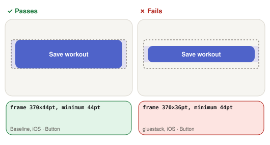

- **touch target:** Measures the control’s frame in the accessibility tree.
  - **Passes:** At least 44 × 44 pt on iOS (Apple’s default control size) and 48 × 48 dp on Android (Google’s minimum).
  - **Fails:** Either side is smaller, so it is easy to miss with a finger.

<a id="name-role-state"></a>

#### name, role, state

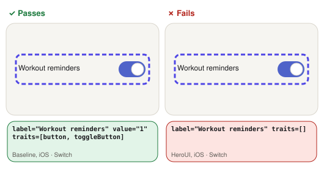

- **name, role, state:** Reads the control from the accessibility tree.
  - **Passes:** It has a label, the right role (button, switch, checkbox…) and its current state: disabled, busy, on/off, checked or selected.
  - **Fails:** Any of the three is missing or wrong, e.g. a switch read as just “Workout reminders”.

<a id="all-options-exposed"></a>

#### all options exposed

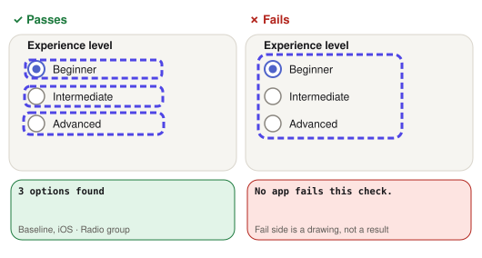

- **all options exposed:** Counts the radio options in the accessibility tree.
  - **Passes:** All three options are separate elements the screen reader can move to.
  - **Fails:** Fewer than three: options are merged into one element or missing.

<a id="group-label-read"></a>

#### group label read

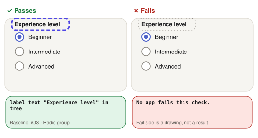

- **group label read:** Looks for the radio group’s label in the accessibility tree.
  - **Passes:** The label “Experience level” is in the tree.
  - **Fails:** It is drawn on screen but the screen reader can’t reach it.

<a id="error-shown"></a>

#### error shown

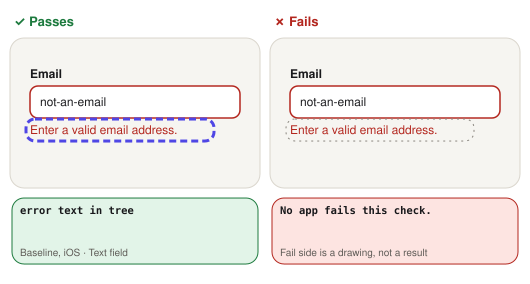

- **error shown:** Types “not-an-email” into the email field, moves focus away, then looks for the error.
  - **Passes:** The message “Enter a valid email” appears in the tree.
  - **Fails:** The error never appears in the tree.

<a id="error-reachable-from-field"></a>

#### error reachable from field

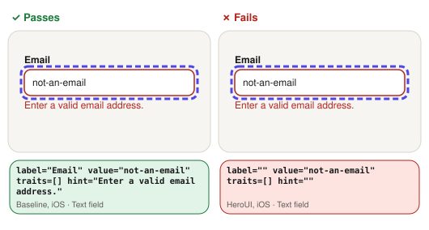

- **error reachable from field:** Reads the email field after the error appears.
  - **Passes:** The error is part of the field’s label, value or hint, so it is read with the field.
  - **Fails:** The field is read without the error, so a screen reader user has to go looking for it.

<a id="opens"></a>

#### opens

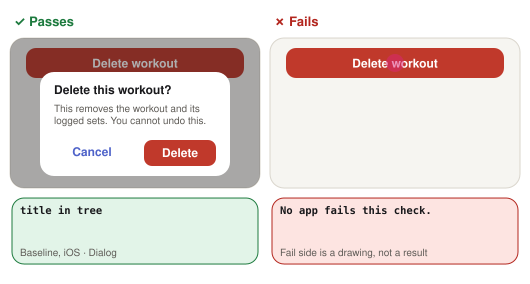

- **opens:** Taps the trigger and waits for the overlay’s content in the tree.
  - **Passes:** Its title or content appears.
  - **Fails:** Nothing appears in the tree after the tap.

<a id="screen-behind-is-hidden-from-the-screen-reader"></a>

#### screen behind is hidden from the screen reader

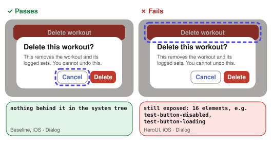

- **screen behind is hidden from the screen reader:** With the overlay open, lists every element the screen reader can reach.
  - **Passes:** Only the overlay’s own elements: nothing from the screen behind it.
  - **Fails:** Controls behind the overlay can still be reached, e.g. “Delete workout, button” behind the dialog.

<a id="title-is-a-heading"></a>

#### title is a heading

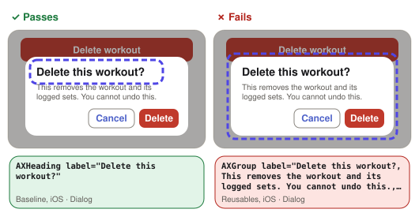

- **title is a heading:** Reads the dialog title’s role.
  - **Passes:** The title has the heading role, so it is read as “…, heading”.
  - **Fails:** It is read as plain text.

<a id="actions-are-buttons"></a>

#### actions are buttons

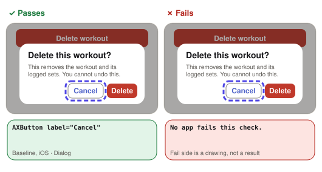

- **actions are buttons:** Reads the role of the dialog’s Cancel action.
  - **Passes:** It has the button role.
  - **Fails:** It is read as plain text, so the user isn’t told it can be activated.

<a id="closes"></a>

#### closes

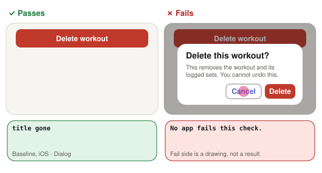

- **closes:** Taps the overlay’s own Close or Cancel button.
  - **Passes:** The overlay leaves the tree.
  - **Fails:** It is still open.

<a id="title-and-body-readable"></a>

#### title and body readable

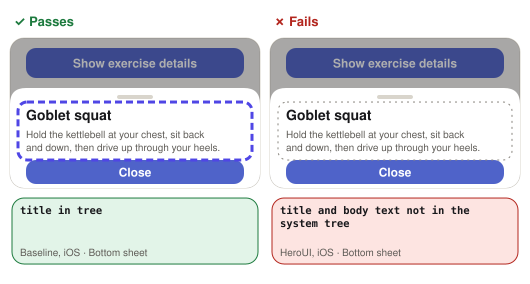

- **title and body readable:** Looks for the sheet’s title and body text in the tree.
  - **Passes:** Both are in the tree.
  - **Fails:** The text is drawn but the screen reader can’t reach it.

<a id="screen-reachable-again-after-close"></a>

#### screen reachable again after close

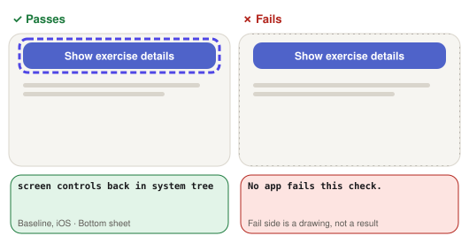

- **screen reachable again after close:** After the sheet closes, looks for the screen’s controls in the tree.
  - **Passes:** They are back, so the screen reader can use the screen again.
  - **Fails:** They are still hidden, as if the sheet were open.

<a id="current-option-marked"></a>

#### current option marked

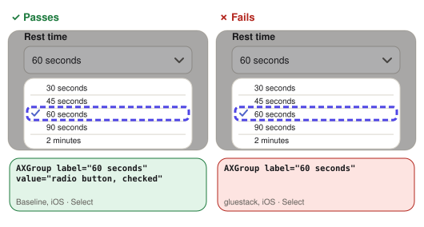

- **current option marked:** Opens the select and reads the option that is already chosen (60 seconds).
  - **Passes:** It is marked as selected or checked.
  - **Fails:** Nothing says which option is chosen.

<a id="options-are-actionable"></a>

#### options are actionable

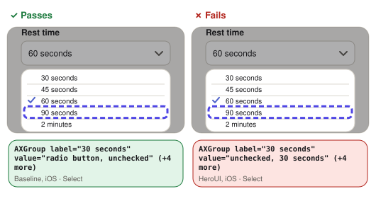

- **options are actionable:** Reads the role of every option in the open select.
  - **Passes:** Each has a button, radio or option role.
  - **Fails:** At least one is read as plain text.

<a id="new-value-read-on-trigger"></a>

#### new value read on trigger

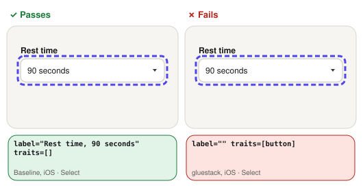

- **new value read on trigger:** Picks 90 seconds, then reads the select’s trigger.
  - **Passes:** The trigger reads the new value.
  - **Fails:** It still reads the old value, or no value.

<a id="screen-reader-can-find-it"></a>

#### screen reader can find it

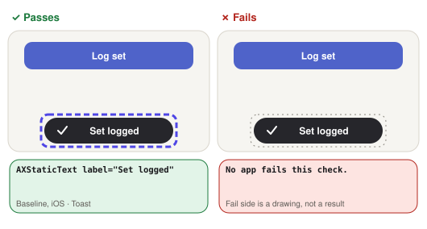

- **screen reader can find it:** Shows the toast and looks for its text in the tree within 3 s.
  - **Passes:** The toast is in the tree while it is on screen.
  - **Fails:** It is drawn but not in the tree, so the screen reader never finds it.

<a id="test-could-start"></a>

#### test could start

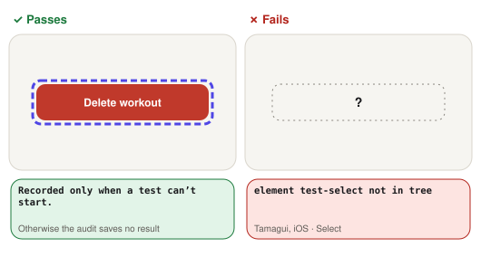

- **test could start:** Looks for the element the test starts from.
  - **Passes:** It was there, so the test’s other checks ran.
  - **Fails:** It wasn’t, so the test’s other checks are marked not run (n/r).

<a id="name-role-value"></a>

#### name, role, value

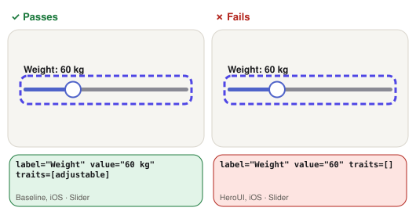

- **name, role, value:** Reads the slider from the accessibility tree.
  - **Passes:** It has a label, the adjustable role and its current value.
  - **Fails:** Any of the three is missing.

<a id="dragging-changes-the-value"></a>

#### dragging changes the value

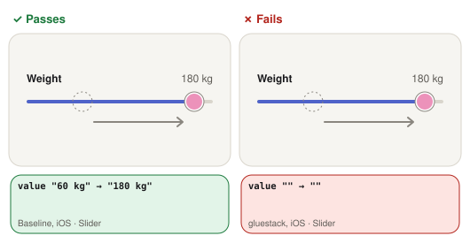

- **dragging changes the value:** Drags the thumb across the track and reads the value before and after. It stands in for the screen reader’s adjust gesture.
  - **Passes:** The value in the tree changes.
  - **Fails:** The value stays the same.

<a id="name-and-value"></a>

#### name and value

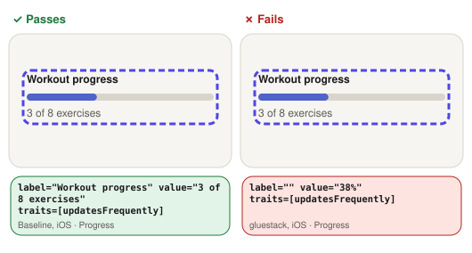

- **name and value:** Reads the progress bar from the accessibility tree.
  - **Passes:** It has a label and its current value.
  - **Fails:** The label or the value is missing.

<a id="header-is-a-button"></a>

#### header is a button

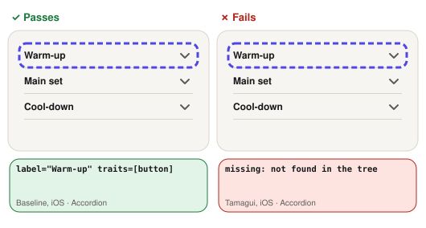

- **header is a button:** Reads the role of the accordion’s first header.
  - **Passes:** It has the button role.
  - **Fails:** It is read as plain text.

<a id="expanded-state-exposed"></a>

#### expanded state exposed

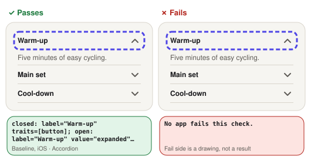

- **expanded state exposed:** Reads the header closed, taps it, and reads it open.
  - **Passes:** It reads as expanded when open and not when closed.
  - **Fails:** It reads the same either way.

<a id="content-shows-and-hides"></a>

#### content shows and hides

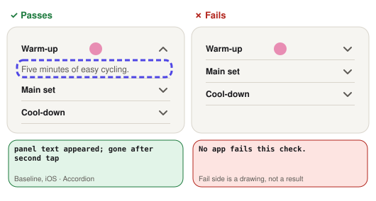

- **content shows and hides:** Taps the header twice, looking for the section text after each tap.
  - **Passes:** The text appears on the first tap and goes on the second.
  - **Fails:** It doesn’t appear, or doesn’t go.

<a id="trigger-name-and-role"></a>

#### trigger name and role

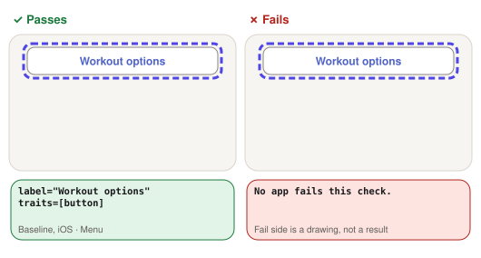

- **trigger name and role:** Reads the menu button from the accessibility tree.
  - **Passes:** It has a label and the button role.
  - **Fails:** The label or the role is missing.

<a id="items-are-buttons"></a>

#### items are buttons

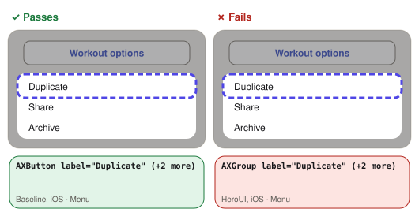

- **items are buttons:** Reads the role of each menu action.
  - **Passes:** Each has the button role.
  - **Fails:** At least one is read as plain text.

<a id="closes-after-an-action"></a>

#### closes after an action

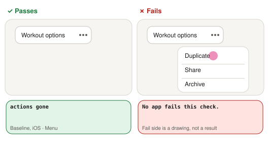

- **closes after an action:** Taps the first menu action.
  - **Passes:** The menu leaves the tree.
  - **Fails:** It is still open.

<a id="options-have-name-and-role"></a>

#### options have name and role

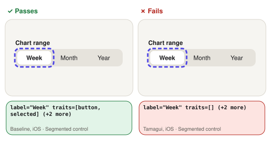

- **options have name and role:** Reads each segment of the segmented control.
  - **Passes:** Each has a label and a button, radio or tab role.
  - **Fails:** A label or role is missing.

<a id="selected-option-marked"></a>

#### selected option marked


- **selected option marked:** Reads every segment’s state.
  - **Passes:** The selected one is marked as selected or checked, and the others aren’t.
  - **Fails:** Nothing says which is selected.

<a id="selection-moves-on-tap"></a>

#### selection moves on tap

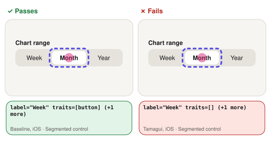

- **selection moves on tap:** Taps the second segment and reads the states again.
  - **Passes:** The selected state moves to it.
  - **Fails:** It stays on the first, or isn’t marked at all.

<a id="everything-the-screen-reader-lands-on-has-a-name"></a>

#### everything the screen reader lands on has a name

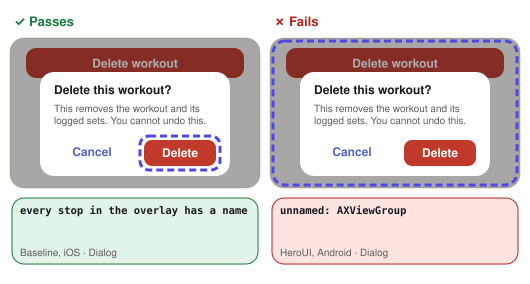

- **everything the screen reader lands on has a name:** With the overlay open, lists every element the screen reader can move to (each “stop”) and looks for any without a label.
  - **Passes:** Every one has a name.
  - **Fails:** At least one has none, e.g. a full-screen dimmed backdrop that TalkBack reads as “Unlabelled”.
<!-- end:glossary -->

<a id="performance-checks"></a>

## Performance checks

- **Devices:** an iPhone 12 Pro and the Android phone, both by cable.
  - Until 2 November 2026 the iOS numbers came from the iPhone 17 simulator. Those results are kept in `results/<app>/ios-perf.*` and `ios-metrics.*`; the phone's are in `iphone-perf.*` and `iphone-metrics.*`
- **Builds:** Release.
- **Runs:** ten each, reported as the median and the range.

**What's measured:**

- Mount time and commit count for the 200-row list (React profiler)
- Commits and time to re-render after switching theme
- JS bundle size (`expo export`, once per platform), compared with an app that uses no library
  - Android added on 2 November 2026
- Cold start to first screen (`expo-router` index mounted)

**Added on 27 October 2026** (`scripts/metrics-run.mjs`, `scripts/rerender-run.mjs`):

- **Startup**
  - Terminate, `launch-app`, then wait until the screen title is in the accessibility tree
  - Median of 10
- **Memory:** `footprint` phys_footprint
  - At idle
  - After using the list and every overlay
- **Scrolling**
  - The app's CPU time during 5 list flings
  - Frame hitches, from Instruments' Animation Hitches template on the iPhone (added on 2 November 2026). The simulator can't record them: the template says "Hitches is not supported on this platform"
  - On the phone, XCUITest injects each fling, which takes a few seconds and makes the app answer accessibility queries, so the CPU time includes that work. It is the same for every app
- **Re-renders on a theme switch**
  - React commits and component renders, from argent's React profiler
  - Debug build, counts only
  - iOS on the simulator: argent's React profiler doesn't support a physical iPhone
  - Android on the Galaxy A15 (added on 2 November 2026). The first profiling session after connecting records no renders, so one unmeasured session goes first
  - Tamagui's Debug build crashes on iOS but runs on Android, so it has Android counts only. A closed Select keeps a `display: none` view, which trips React Native's Debug-only layout assertion, [react-native#52349](https://github.com/react/react-native/issues/52349). Traced in [Tamagui's notes](../apps/tamagui/NOTES.md#ios-debug-build-crashes-traced-4-november-2026)

<a id="ease-of-use-log"></a>

## Ease-of-use log

Each app's `NOTES.md` records:

- The setup steps and config files touched
- Every error hit while building it, and how it was fixed
- Lines of code for the test screen

<a id="limits"></a>

## Limits

- **Screen readers**
  - The checks read the tree VoiceOver and TalkBack are given
  - They don't listen to what is spoken or check the swipe order
  - Switch Control and Switch Access aren't tested
- **One device each**
  - iOS: an iPhone 12 Pro for performance, the simulator for everything else
  - Android: one budget phone
  - An Android emulator was tried first. Emulator 37.1 and 37.2 crashed repeatedly, so no emulator numbers are reported
- **iOS**
  - First paint isn't measured
  - On the phone, Instruments can't attach to the app's process, so it records every process and the app's rows are picked out by process id
  - The timing clock runs in JS, so libraries that apply styles natively (Unistyles, Tamagui's native runtime) may do work it doesn't see
  - Some Tamagui elements aren't in argent's view-hierarchy walk. Those checks read the system tree, which gives no selected state
  - Tamagui's RadioGroup doesn't draw the selected dot, although the tree reports it as checked
- **Android**
  - The phone was charging, with power saving off and no thermal throttling
- **Both platforms**
  - Turning reduced motion on while an app runs wasn't tested

<a id="reproduce"></a>

## Reproduce

**You need:**

- [argent](https://github.com/software-mansion/argent), for device control
- ffmpeg, for the reduced-motion recordings

**iOS**

```bash
scripts/build-ios.sh <app> Release
```

```bash
scripts/run-all.sh <simulator-udid>
```

**Performance on an iPhone:** keep it unlocked (Auto-Lock: Never), plugged in and out of Low Power Mode. The build is signed with team 5ES874S4M4; set `TEAM` for another.

```bash
scripts/build-ios.sh <app> Release <iphone-udid>
```

```bash
scripts/run-all-iphone.sh <iphone-udid>
```

**Re-render counts:**

1. Build Debug and start Metro
2. Install with `scripts/audit-app.sh <app> <udid> Debug`
3. Then run:

```bash
node scripts/rerender-run.mjs <app> dev.asimmalik.uilab.<app> <simulator-udid>
```

**Android**

**1. Build and install each app** on a phone with USB debugging on:

```bash
scripts/build-android.sh <app> Release
```

```bash
adb -s <serial> install -r -g apps/<app>/android/app/build/outputs/apk/release/app-release.apk
```

**2. Run every check** for the apps you name. The script:

- Builds and installs the accessibility reader (`scripts/android-a11y-dump`)
- Keeps the screen awake
- Restores the font scale and animation settings it changes

```bash
scripts/run-all-android.sh <serial> baseline unistyles
```

**3. Re-render counts.** Builds each app's Debug .apk, installs it, starts Metro and runs the profiler. Release builds have to be reinstalled afterwards for the other checks:

```bash
scripts/rerender-android.sh <serial> baseline unistyles
```

**Tables and report**

```bash
node scripts/readme-tables.mjs
```

```bash
node scripts/checks-md.mjs
```

```bash
node scripts/site.mjs
```

**Other scripts:**

- `scripts/contrast.mjs`: checks the shared tokens against WCAG contrast
- `scripts/devcost.mjs`: the developer-cost table
- `scripts/bundle-size.mjs`: bundle sizes

<!-- begin:navfoot -->

---

← [Back to README](../README.md)
<!-- end:navfoot -->
